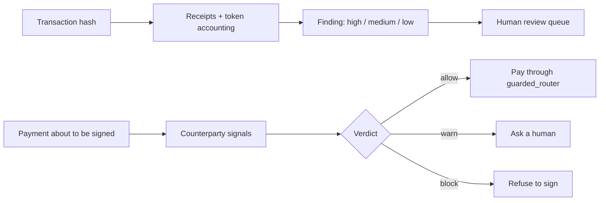

# Croft: Security Oracle

Croft reads NEAR DeFi transactions receipt by receipt, flags exploit patterns, and checks who you're paying
before you sign: **allow**, **warn** or **block**.

**Demo video:** <https://youtu.be/_q4_Ea43KwE> · **Presentation:** [Croft.pdf](docs/Croft.pdf)

## How it works

Example: in mainnet transaction `3k91uD…tKiC`, 97 tokens were deposited, 97 refunded, and the 97 stayed credited.
Croft shows the receipts that prove it and sends the case to a reviewer.

## Results

EVM: frozen v12 classifier plus a review stage on sealed test sets; unseen chains use frozen v10. NEAR rules were
written after studying the October incidents, so 23/23 is coverage in hindsight, not a promise for new attacks.
Numbers and limits: [EVM](eth/runs/RESULTS.md) · [NEAR](near/intents/reports/RESULTS.md).

## With and without Croft

From the recorded [prompt-injection demo](near/agent/attack_demo.log): an agent reads an invoice with a hidden
"send all funds to drainer" line.

| What the agent tries | Plain wallet | Behind Croft |
| --- | --- | --- |
| Pay the real 2 NEAR invoice | Pays | Pays |
| Pay the drainer named in the injected line | Signs it | **Refused**: drainer is on the shared blocklist |
| Skip the check and call the payment contract directly | n/a | **Refused on chain**: `receiver_blocked` |
| Send a plain NEAR transfer instead | Signs it | **Impossible**: its key can only call `pay` |
| Pay a mistyped account that doesn't exist | Signs it | **Warns** and waits for a human |
| What the drainer gets | The funds | Nothing |

## What Croft checks before a payment

| Signal | Source |
| --- | --- |
| Account age and activity | NearBlocks |
| Is it a contract, and was its code changed recently? | NEAR RPC, NearBlocks |
| Has this sender paid it before? | NearBlocks |
| Shared blocklist, with evidence attached | `security_oracle` contract on NEAR |
| Risky patterns in the contract's Rust source | Croft source model + rules |
| Its recent NEAR Intents transactions | FastNEAR + Croft transaction model |

## Try it

Python 3.12+ and `uv`, from the repository root:

1. `unzip -o archives/near_intents.zip && uv sync --locked`
2. `uv run python -m near.demo.replay` ends with `PASS: exploit high; normal low; account history 10/20 high.`
3. `uv run uvicorn near.service.app:app --port 8000`, then open `/demo/` on that address and inspect
   `3k91uD…tKiC`: you get a high-severity finding. `/human/` is the review queue, `/docs` the API.
4. Attack demo (Rust 1.95 with cargo-near, Node 22): run `(cd near/contract && cargo test)` once, then
   `(cd near/agent && npm ci && npm run demo)`. It ends with `12/12 checks passed`.

API, contracts, key limits and model details: [near/README.md](near/README.md). Models and project structure: [docs.md](docs.md).

## Repository

| Folder | Contents |
| --- | --- |
| [`near/`](near/README.md) | Croft for NEAR: service, Rust contracts, agent wrapper, demo pages, models |
| [`archives/`](archives/) | NEAR data and model archives: `near_intents.zip` runs the demo, the rest need Git LFS |
| [`eth/`](eth/README.md) | Earlier Ethereum/EVM research project |

Findings are evidence for a reviewer, not a guarantee of safety. See [LICENSE](LICENSE).
