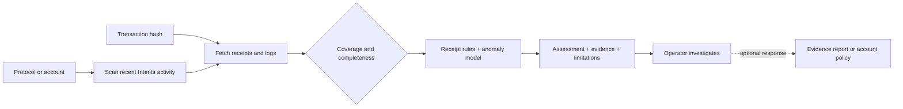
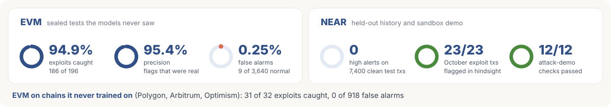

# NEAR Protocol Security Agent

**Inspect a transaction. Find the attack pattern. See the evidence.**

A protocol investigation agent for NEAR: submit a mainnet transaction hash or scan an account's recent activity.
It reads receipt graphs, logs, callback failures and refunds, then explains what looks suspicious.

[Run it](near/README.md) · [Intents evidence](near/intents/reports/RESULTS.md) · [API reference](http://localhost:8000/docs)



## The result

| Assessment | What it means |
|---|---|
| **High-severity pattern** | A high-severity known attack pattern was observed; investigate the evidence |
| **Suspicious** | Anomalous behavior or medium-severity rules need review |
| **No known pattern** | Nothing reached an alert threshold in the available, supported data; **not proof of safety** |
| **Inconclusive / unsupported** | Evidence is incomplete or the transaction is outside calibrated coverage |

You can submit **any well-formed NEAR mainnet transaction hash**. The current detector is calibrated on **NEAR
Intents**, not every NEAR protocol. Unsupported transactions are identified explicitly. It inspects completed
transactions; it does not simulate pending transactions or automatically stop an exploit.

## What it looks for

| Evidence | Why it matters |
|---|---|
| Failed resolve callback | Refund or deposit accounting may not have completed |
| Log near the 16 KB limit | Callback execution may fail during bookkeeping |
| Credit retained after a refund | Internal credit may no longer be backed by tokens |
| Out-of-gas callbacks, direct private/admin calls | Suspicious execution paths or probing |

The explanation includes rule hits, transaction identities, receipt coverage and model identity.
A protocol scan scores up to **20 Intents transactions among an account's 40 most recent**, cached five minutes.
This is a bounded scan, not continuous monitoring or a complete account audit.

## Try it

```bash
# One-time setup: near/README.md
uv run uvicorn near.service.app:app --port 8000
# Open http://localhost:8000/demo/

# Deterministic evidence replay; no network or keys
uv run python -m near.demo.replay
```

| Demo input | What to show |
|---|---|
| October exploit preset | High-severity callback, log and credit evidence |
| Normal deposit preset | No known attack pattern, with coverage shown |
| Known missed token-spoof preset | A real detection limitation, clearly labelled |
| `intents.near` or October exploiter scan | Recent transactions; open any row for the full analysis |

## Evidence, not a guarantee



**23/23** October exploit transactions flagged high; one known technique repeated by one actor.
**0/7,400** clean normal test transactions flagged high (95% upper bound: 0.052%). Rules were developed after
seeing the campaigns. The anomaly model added no campaign detections and produced **84/7,400 medium alerts**.
[Detailed evaluation](near/intents/reports/RESULTS.md)

## Optional integrations

- **Rust source analysis:** inspect contract code alongside transaction evidence. Most real bugs are missed;
  this is a supporting signal. [Code-model evidence](near/model/reports/RESULTS.md)
- **On-chain response:** an operator can review evidence, publish an account verdict or confirm a report.
  The supplied router enforces that policy on future native NEAR payments routed through it. It cannot undo the
  inspected transaction, pause an arbitrary protocol, or turn a transaction label directly into an account block.
  [Contracts](near/contract/README.md) · [Response client](near/agent/README.md)

<details>
<summary>Project provenance</summary>

- **Pre-hackathon code:** the EVM security oracle (first committed 2026-10-15) predates the hackathon and lives on
  the `main` branch. `near/` reuses its method (grouped CV, frozen model with hashes, sealed test scored once) but
  none of its code. Everything under `near/` was built during the hackathon. The 2026-11-14 commit f567294 in
  this branch's history is an EVM state sync, not part of the submission.
- **AI-generated code:** most code, data tooling and docs under `near/` were written with Claude Code, directed and
  reviewed by the author. Label re-checks and fix-commit triage were also done by AI agents.

</details>

[Setup & API](near/README.md) · [License: BUSL-1.1](LICENSE)
