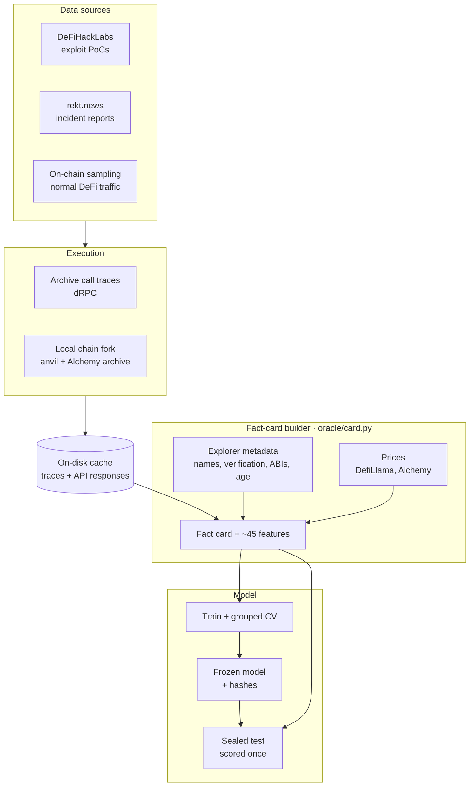
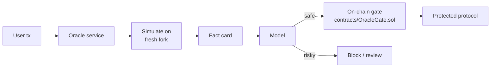
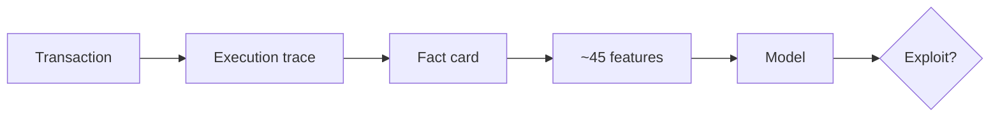
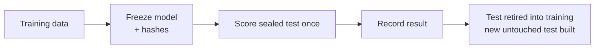

# Security Oracle

Detects DeFi exploits **before they execute**. A transaction is traced or simulated, turned into a priced summary of
who gained and who lost (a "fact card"), and scored by a small frozen model.

> [!IMPORTANT]
> On sealed test sets the model never trained on, it caught **112 of 114 real exploits** across 5 chains, with
> **0 false alarms on 1,441 normal transactions** outside Ethereum.
> On Ethereum DeFi traffic it raised **1.28% false alarms**, so precision is **below the 95% target**. That's the
> current focus.

## Architecture



| Layer | Code | Role |
|---|---|---|
| Collection | `scripts/extract_exploits.py`, `build_dataset.py`, `collect_testset.py`, `build_background.py` | find exploit and normal transactions on 6 chains |
| Execution | `scripts/build_dataset.py` (traces), `oracle/replay.py` (fork replay) | get the exact execution of each transaction |
| Data clients | `oracle/sources.py` | archive RPC, explorer, prices; rate-limited and cached |
| Card builder | `oracle/card.py`, `oracle/category.py` | turn an execution into a fact card and features |
| Model | `scripts/eval_nested.py`, `freeze_v9.py`, `eval_test2.py` | train, freeze, score sealed tests |

**In production (planned):** a protocol opts in, and its contracts only accept transactions that passed the oracle.



## How it works



**1. Get the execution.** We obtain the exact execution of every transaction:
- **Ethereum, Base and Polygon:** an archive node's call trace (`debug_traceTransaction`).
- **Other chains:** the transaction is re-executed on a local fork of the chain at the block before it, and kept only
  if the result matches the real one. In production this same step simulates a transaction *before* it lands.

**2. Build the fact card.** From the trace's calls and token transfers:
- **Who is who:** contract names and verification status from the block explorer. Unverified contracts stay anonymous,
  so attacker-chosen names never reach the model.
- **What it's worth:** every transfer priced in USD at the transaction's time.
- **Net per party:** gains and losses netted across all tokens, so a normal swap cancels out and a drain doesn't.
- **The protected protocol's view:** what it lost and who called it.

A real exploit card, shortened (*WhereIsMyDragonTreasure*, a training example):

```json
{
  "protected_protocol": {"net_change": "-$47.4k", "largest_outflows": ["$47.4k ETH out = 50% of its ETH"],
                         "signer_history": "0 earlier txs from this signer to the protocol"},
  "signer": "EOA with nonce 364",
  "target": "7702-delegated EOA (running delegated code), called directly by signer",
  "flash_loans": "none",
  "signer_side_net": "+$47.4k",
  "call_path": ["ERC1155V1.safeBatchTransferFrom", "WhereIsMyDragon.onERC1155BatchReceived", "ERC1155V1.burnBatch"]
}
```

**3. What the model decides from.** About 45 numbers taken from the card:

| Group | Examples |
|---|---|
| Value flows | attacker-side net gain, protocol net loss, share of a holding drained, third-party wallet losses |
| Attacker setup | fresh signer, unverified or just-deployed contract, contract created in the tx, EIP-7702 delegation |
| Mechanics | flash loans, re-entrancy, call depth, tokens minted to the attacker, a token's supply moved in one tx |
| Context | operation type (liquidation, withdraw, swap, Safe execution), signer is the protocol's owner |

The model is a logistic regression with a fixed threshold. It is small and auditable, and every decision traces back
to card numbers.

## Results (sealed tests, each scored once)

| Test | Exploits caught | False alarms |
|---|---|---|
| v3: Arbitrum, Optimism, Polygon (chains never seen) | **31/32** (96.9%) | **0/918** |
| v2: BSC, Base | **81/82** (98.8%) | Base 0/389 · BSC 0/134 · **Ethereum 32/2,503 (1.28%)** |
| v1: Ethereum, BSC (older model) | 62/66 (93.9%) | 12/847 (1.42%) |

### Where it works and where it fails (Ethereum normals in v2)

| Transaction family | False alarms | In training? |
|---|---|---|
| Liquidations (Aave, Compound, Morpho) | 0 / 240 | yes |
| Aggregator swaps (1inch, 0x, Universal Router) | 0 / 280 | yes |
| Uniswap swaps and LP | 0 / 170 | yes |
| Bridges, timelocks, Lido deposits, Convex, Pendle, Maker flash loans | 0 / 295 | yes |
| NFT trades (Seaport), EigenLayer deposits | 0 / 110 | no |
| Flash loans (Aave, Balancer, Morpho, Uniswap V3) | 5 / 647 | yes |
| MEV bots, Safe execution, CoW settlement, sDAI deposits | 5 / 360 | yes |
| **Lido withdrawal claims** | **8 / 50** | **no** |
| **Vault (sDAI) withdrawals** | **5 / 50** | **no** |
| **Aave supply / borrow / withdraw, Compound v3 withdraw** | **9 / 300** | **no** |

**Why it fails:** for a withdrawal, the card saw the protocol paying out but not the claim the user gave up (a
withdrawal NFT or burned vault shares), so it looked like a drain. Families seen in training stayed at about 1% or
less; the failures are concentrated in unseen withdrawal-type flows. The next version counts surrendered claims, and
those families are now in training.

## Training vs testing: kept separate



| Set | Used for | Exploits / normals |
|---|---|---|
| Training (v10) | fitting the frozen model | 152 / 1,214 |
| Sealed v2 | testing only | 82 / 3,026 |
| Sealed v3 | testing only | 32 / 918 |
| Sealed v4 | being built, untouched | – |

- **No shared transactions:** zero overlap between training and any test, checked automatically before scoring.
- **No shared victims:** a test exploit never targets a contract that appears in training. Cross-validation is grouped
  by victim contract too.
- **Frozen first:** the model, its threshold, and hashes of the code and training data are saved before a test is
  scored. The scorer refuses to run if anything changed.
- **Verified labels:** every exploit was checked against its incident report and must move value in its own trace.
  Normals from just before an attack are excluded, because they can be part of it.
- **Scored once:** a test is scored a single time and then retired into training. Measuring again needs a new test.

Full results log: `runs/RESULTS.md`.

## Limits

- Precision at real-world exploit rates needs false alarms in the **tens per million**; we measure **thousands**.
  The plan is a second stage with protocol-specific checks (liquidations, withdrawals, Safe approvals).
- Results come from historical transactions, not yet from live pre-execution simulation.
- Exploit counts per chain are small, so the confidence intervals are wide.

## Repository

| Path | What |
|---|---|
| `oracle/` | Fact-card builder (`card.py`), data clients (`sources.py`), fork replay (`replay.py`) |
| `scripts/` | Data collection, card building, label checks, evaluation, freezing, sealed scoring |
| `contracts/` | Proof-of-concept on-chain gate (Foundry) |
| `models/` | Frozen models with metadata and hashes (from `archives/models.zip`) |
| `archives/` | Zipped `data/` and `models/` (Git LFS) |
| `runs/` | Results log and reports (local only) |

## Data and models

`data/` and `models/` are not tracked directly. They ship as two zips in `archives/`, stored with Git LFS:

| Zip | Contents |
|---|---|
| `archives/datasets.zip` | `data/` (exploit and normal rows, fact cards, replays, raw pulls), without the RPC cache |
| `archives/models.zip` | `models/` (frozen classifiers, tx-hash manifests, `laya_frozen_v7` weights) |

```bash
git lfs install            # once per machine
git lfs pull               # fetch the zips if the clone only got pointers
unzip archives/datasets.zip   # restores ./data
unzip archives/models.zip     # restores ./models
```

Each zip unpacks into the repo root under its original path. `data/cache/` (about 9 GB of Alchemy and Etherscan responses) is not included. Scripts refill it on demand, which needs API keys and takes longer.

## Run it

Keys go in `.env` (`ALCHEMY_KEY`, `ETHERSCAN_API_KEY`) and `rpc.json`. Both are gitignored.

```bash
uv sync
uv run python scripts/build_dataset.py                    # trace exploits + normals
uv run python scripts/make_cards.py --version v10         # fact cards + features
uv run python scripts/verify_labels.py --cards data/cards_v10.jsonl
uv run python scripts/eval_nested.py --cards data/cards_v10_clean.jsonl
uv run python scripts/freeze_v9.py --cards data/cards_v10_clean.jsonl --model logreg --tag v10
uv run python scripts/eval_test2.py --cards <sealed_test_cards.jsonl> --tag v10 --name <test>
```
