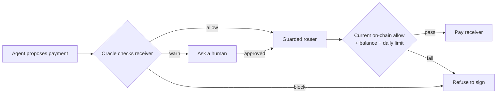

# NEAR Security Oracle

A security check for AI agents spending NEAR. Returns **allow · warn · block**, with reasons.

[Run the demo](near/README.md) · [Track 06](https://github.com/nearai/near-hackathon-prompt-examples/blob/main/tracks/06-security.md)



**Even a compromised agent cannot bypass the router:** its key can only call `router.pay`.
Human approval does not override the router's checks.

## What it checks

| Counterparty | Contract | Intents activity |
|---|---|---|
| Age, history, prior interactions | Rust source model + rules | Failed callbacks, oversized logs, retained credit |
| Evidence-backed blocklist | Code changes; unverified source warns | Recent receipt graphs; high risk warns |

## What we measured


| Clean normal test sample | Enforcement demo | Code model |
|---|---|---|
| **0 / 7,400 high alerts** | **12 / 12 checks passed** | **3–8% high-threshold recall** |
| 95% upper bound: 0.052% | Real contracts, local sandbox | v1 and v2; model alone only warns |

**Caveats:** campaigns are retrospective and the rules were written after these attacks; 23 exploits repeat one
known technique. Rules supplied all campaign detections. The anomaly model added none and raised medium false alarms to 1.14%.
[Full evidence](near/intents/reports/RESULTS.md) · [Code-model results](near/model/reports/RESULTS.md)

## Try it

```bash
# After setup in near/README.md
uv run python -m near.demo.replay          # offline: exploit high, normal low
uv run uvicorn near.service.app:app        # open http://localhost:8000/demo/
```

| Demo | Outcome |
|---|---|
| Normal invoice | Merchant receives 2 NEAR |
| Injected drainer payment | Wrapper refuses |
| Agent bypasses wrapper | Router refuses |
| Agent transfers directly | Function-call key rejects it |

[Run the attack demo](near/agent/README.md) · [Actual log](near/agent/attack_demo.log)

## Scope

Native NEAR payments only, tested in a local sandbox, not audited. Historical activity informs future checks; this does not
simulate a pending transaction or prove prevention of an unseen exploit. Attesters are trusted; source is not
verified against deployed WASM. [Contract limits](near/contract/README.md)

```text
near/service/    API + decision policy
near/intents/    Receipt rules + evaluation
near/agent/      Scoped-key wrapper + attack demo
near/contract/   Oracle + payment router
near/model/     Rust code model
near/demo/      Browser + offline demo
```

## Disclosure

- **Pre-hackathon code:** the EVM security oracle (first committed 2026-10-15) predates the hackathon and lives on
  the `main` branch. `near/` reuses its method (grouped CV, frozen model with hashes, sealed test scored once) but
  none of its code. Everything under `near/` was built during the hackathon. The 2026-11-14 commit f567294 in
  this branch's history is an EVM state sync, not part of the submission.
- **AI-generated code:** most code, data tooling and docs under `near/` were written with Claude Code, directed and
  reviewed by the author. Label re-checks and fix-commit triage were also done by AI agents.

[Setup & API](near/README.md) · [License: BUSL-1.1](LICENSE)
