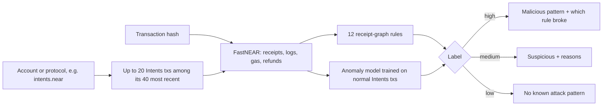

# NEAR Protocol Security Agent

Paste a NEAR transaction hash and see whether it looks like an attack, and which invariant broke.



The agent rebuilds the transaction's receipt graph from mainnet and checks it against rules taken from real NEAR
Intents attacks, plus an anomaly model trained and calibrated on 87,635 normal Intents transactions (tested on
12,463 more). You can also scan an account or a
protocol: of its 40 most recent transactions, it scores up to 20 that touch NEAR Intents and counts them per label.
**Low never means safe.** It means no high or medium rule fired and the anomaly score stayed under its
thresholds.

| Rule | Severity | What broke |
|---|---|---|
| Failed resolve callback | high | A token transfer's `resolve` callback failed, so the refund accounting may be wrong |
| Log near the 16 KB limit | high | A receipt failed on NEAR's log length limit, or wrote a log over 90% of it |
| Credit kept while the token refunded | high | The token went back to the sender while Intents still credits it (credited + refunded > deposited) |
| Refund larger than deposit, notify receiver inside a deposit, many token ids | medium | Deposit shapes seen in the exploit and the out-of-gas attempts |
| Private method called directly, admin method by a non-role caller | medium (admin: low if the call succeeded) | Someone outside the contract called a callback or a role-gated method |
| Callback out of gas, return value limit | medium (high for a critical callback) | A callback ran out of gas or a receipt hit the return size limit, so bookkeeping may not have run |
| `execute_intents` panic, unknown method | low | Shown as a reason, does not raise the label |

## Who it is for

- **Protocol teams** checking their contracts: scan the contract account and see what was flagged and why. Today
  the scan covers transactions that touch NEAR Intents.
- **Wallets, solvers and agents** checking a transaction or a counterparty's recent history before acting on it.
- **Anyone looking into an incident**: paste the hash and get the receipt-level reasons instead of reading the
  receipts by hand.

## What it catches, by attack type

The agent flags risk; it does not fix contracts or stop transactions. **High** is shown as *Malicious pattern*,
**medium** as *Suspicious*, **low** as *No known attack pattern*.

**How to read the numbers**

- **Recall:** of the real attacks, how many it flagged.
- **Precision:** of everything it flagged, how many were real attacks.
- **False alarms:** of normal activity, how much it flagged by mistake.
- **`84 / 7,400 (1.1%)`:** we took 7,400 normal Intents transactions from Oct–Nov 2026, kept out of training and
  rule writing. It wrongly flagged 84 of them at medium and none at high. 80 of the 84 came from one hour on
  2026-10-01, when Intents was paused and deposits failed. All 84 came from the anomaly model; the rules alone
  flagged none.


### NEAR Intents transactions

Rules were written after studying these attacks, so this is a look back at known attacks, not a test on new ones.

| Attack type | Example | Main rules that fired | Caught at high | Caught at medium or higher |
|---|---|---|---|---|
| Deposit callback overflows its log, credit kept | Sep 29–Oct 1 2026 exploit, about $3.8M | failed callback, log limit, credit kept | **23 / 23** | 23 / 23 |
| Callback runs out of gas | Apr 2026 attempts | notify in deposit, callback out of gas | 0 / 55 | **53 / 55** |
| Private or admin method called by an outsider | May 2026 fuzzing | private method called directly, admin method | 0 / 177 | **110 / 177** |
| Fake-token deposits | May 2026 token spoofing | private method called directly (the 18 caught); the rest look like normal failed intents | 0 / 182 | **18 / 182** |
| *Normal traffic (false alarms)* | 7,400 unseen transactions | — | **0 / 7,400** | 84 / 7,400 |

| | High | Medium or higher |
|---|---|---|
| Recall, all 437 attack transactions | 23 / 437 = 5% (the exploit: 23 / 23) | 204 / 437 = 47% |
| False alarms, 7,400 normal transactions | 0 = 0% | 84 = 1.1% |
| Precision on our test set | 23 / 23 = **100%** | 204 / 300 = 68% |

Precision here uses 437 attacks against 7,417 normal transactions (the 7,400 above plus 17 team tests, 12 flagged
at medium). 5,063 more test transactions were used while writing the rules, so they are left out. Real traffic has
far fewer attacks, so live precision at medium is much lower. The 23 exploit transactions are one attacker
repeating one technique; the attacker's 52 setup and cash-out transactions look normal and were not flagged.

### Contract code (supporting signal)

Trained on 415 real NEAR bugs (250 audit findings, 163 fix commits, 2 incidents) plus 7,313 generated bug variants,
across 15 bug types. Scored once on a sealed test from 27 repositories held out of training (two have forks in
training).

| Bug type | Real training examples | Caught at high | Caught at medium or higher |
|---|---:|---:|---:|
| Logic error | 149 | 4 / 120 | 11 / 120 |
| Missing access control | 58 | 3 / 46 | 6 / 46 |
| Storage staking | 36 | 4 / 21 | 6 / 21 |
| Unhandled promise result | 35 | 4 / 20 | **12 / 20** |
| Async reentrancy | 23 | 0 / 4 | 1 / 4 |
| Gas denial of service | 21 | 1 / 16 | 3 / 16 |
| Unsafe arithmetic | 21 | 0 / 18 | 0 / 18 |
| Missing one-yocto check | 19 | 0 / 10 | 1 / 10 |
| Precision and rounding | 18 | 0 / 13 | 1 / 13 |
| Signer authentication | 11 | 1 / 3 | 1 / 3 |
| Non-private callback | 5 | 0 / 3 | 1 / 3 |
| Oracle price | 6 | 1 / 16 | 3 / 16 |
| Token receiver trust | 7 | 2 / 6 | 2 / 6 |
| Unchecked receiver | 5 | 0 / 2 | 0 / 2 |
| Unguarded upgrade | 1 | 0 / 4 | 0 / 4 |
| *Unclassified* | — | 0 / 1 | 1 / 1 |
| **All real bugs** | **415** | **20 / 303** | **49 / 303** |

| | High | Medium or higher |
|---|---|---|
| Recall, 303 real bugs | 20 / 303 = 6.6% | 49 / 303 = 16% |
| False alarms, 3,699 clean contract functions | 32 = 0.9% | 194 = 5.2% |
| Precision against clean contract functions (about 1 bug per 13) | 20 / 52 = 38% | 49 / 243 = 20% |
| Precision if 1 in 100 functions were buggy (estimate) | about 7% | about 3% |

Counting the fixed versions of the same bugs as false alarms too, precision is 34% at high and 18% at medium.

On 13 real security incidents it never saw (4 exploits, 4 bug bounties, 5 security fixes), it flagged 3 at medium
(both NEAR Intents deposit-notification bugs and the SWEAT callback without `#[private]`) and missed 10. One of
the 3 is also flagged on its fixed code. That is why a code score alone never blocks a payment.

## Try it

```bash
# Setup in near/README.md. Offline, no network: exploit high, normal low
uv run python -m near.demo.replay

# Live UI and API (mainnet reads, needs internet). Open http://localhost:8000/demo/
uv run uvicorn near.service.app:app
```

Paste any mainnet transaction hash, or an account id to scan. Or call the API:

```bash
# October 2026 exploit deposit
curl -s localhost:8000/v1/intents/score -H 'content-type: application/json' \
  -d '{"tx_hash": "3k91uDpUiezxUe7hBgAR7kc3TBkToMZKGAiv6GqbtKiC"}'

# A normal deposit
curl -s localhost:8000/v1/intents/score -H 'content-type: application/json' \
  -d '{"tx_hash": "8tTzvGLMV7x1swmF2A5m3zDugCimdwmDrTXDTvKsJvj"}'

# Scan a protocol: up to 20 Intents txs among its 40 most recent
curl -s localhost:8000/v1/intents/scan -H 'content-type: application/json' \
  -d '{"account_id": "intents.near"}'
```

| Call | What we got (2026-11-14) |
|---|---|
| Exploit deposit | `"label": "high"`; rules: failed resolve callback, log limit, credit kept (high); refund exceeds deposit, notify receiver in deposit, many token ids (medium) |
| Normal deposit | `"label": "low"`, no rules |
| Scan `intents.near` | 20 scored, `"counts": {"high": 0, "medium": 0, "low": 20}`. Live traffic, so this changes |

More sample hashes, all from the labelled set:

| Transaction | Campaign | Label |
|---|---|---|
| `2b4V5vJJmVA7mLXtQR99SA24ssbStTTBW7WcxW6k3qru` | Apr 2026 out-of-gas attempt | medium: notify receiver in deposit |
| `BchE3fwPtgfURL4aFQpDEczFuceM8MR5qaVtBX5Krudx` | May 2026 admin and private-method fuzzing | medium: private method called directly |
| `F5cgTm3kN8XBseeqWhScwure4ARBXUPqVV5JgU9mPvze` | May 2026 token spoof attempt | **low (missed)**; only an `execute_intents` panic note |

Scanning the exploiter account `20e6bfe4685d99004fc2095d3a0fc6158cd810ce8f801196141e183ed6e19d65` gives 10 high
(exploit deposits) and 10 low (withdrawals) out of 20.

## Also in this repo

- **Contract code model** (`POST /v1/analyze`): scores Rust contract source for 15 bug types. It is a supporting
  signal only; its numbers are in [Contract code](#contract-code-supporting-signal) above and
  [its evaluation](near/model/reports/RESULTS.md).
- **Agent payment guard**: an [oracle contract and guarded payment router](near/contract/README.md), plus a
  [scoped-key agent wrapper](near/agent/README.md) that checks a receiver with `POST /v1/check` before paying.
  Tested in a local sandbox ([attack demo log](near/agent/attack_demo.log)).

## Scope and limits

- **Retrospective.** The rules were written after studying these attacks. The numbers above show it recognises
  known attacks again; they do not show it catches new ones. It flags transactions after they land. It does not
  prevent attacks or simulate pending transactions.
- **Calibrated on NEAR Intents.** Thresholds come from `intents.near` traffic. Any mainnet transaction can be
  scored and the rules describe general NEAR receipt patterns, but results for transactions that do not touch
  Intents (`"touches_intents": false`) are less reliable. Account scans only look at transactions that touch Intents.
- **Mainnet via the FastNEAR free tier.** No API key; reads can be slow or rate-limited. FastNEAR sometimes leaves
  out receipts (`"receipts_complete": false`); rules may then miss something.
- **Not audited.** Medium alerts were 1.1% of normal test traffic, mostly from one paused hour. Treat a label as a
  lead to look into, not a verdict.

[Full Intents evidence](near/intents/reports/RESULTS.md)

```text
near/service/    API: score a tx, scan an account, check a receiver
near/intents/    Receipt-graph rules, anomaly model, evaluation
near/demo/       Browser + offline demo
near/model/      Rust code model
near/contract/   Oracle + payment router contracts
near/agent/      Scoped-key wrapper + attack demo
```

## Disclosure

- **Pre-hackathon code:** the EVM security oracle (first committed 2026-10-15) predates the hackathon and lives on
  the `main` branch. `near/` reuses its method (grouped CV, frozen model with hashes, sealed test scored once) but
  none of its code. Everything under `near/` was built during the hackathon. The 2026-11-14 commit f567294 in
  this branch's history is an EVM state sync, not part of the submission.
- **AI-generated code:** most code, data tooling and docs under `near/` were written with Claude Code, directed and
  reviewed by the author. Label re-checks and fix-commit triage were also done by AI agents.

[Setup & API](near/README.md) · [License: BUSL-1.1](LICENSE)
