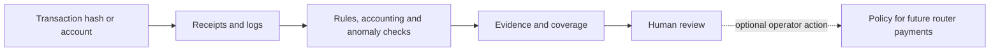

# Croft

**A security oracle for NEAR Intents: inspect a transaction, understand suspicious activity, and review the evidence.**

NEAR transactions execute across asynchronous receipts. A failed callback can leave internal credit behind
even after tokens are refunded. Croft follows those receipts,
checks deposit/refund/credit events, and shows operators what happened and what evidence is missing.

[Run locally](#run-locally) · [Evidence & results](near/intents/reports/RESULTS.md) · [Technical guide](near/README.md)

## What you can do

- **Inspect a transaction:** paste a NEAR mainnet hash to see receipt failures, suspicious calls, exact token amounts and related earlier activity.
- **Scan an account:** inspect up to 20 Intents transactions among its 40 most recent entries, then open individual findings.
- **Review findings:** suspicious and high-severity cases enter a human dashboard; confirm, dismiss or reopen them with a saved note.
- **Control future payments:** optional Rust contracts and payment adapters enforce operator account policies or signed approvals through a guarded router.



Checks look for failed callbacks, excessive logs, out-of-gas execution, direct private/admin calls, and credit
retained after a refund. Results distinguish **high-severity patterns**, **suspicious activity**, **no known pattern**
and **inconclusive/unsupported evidence**. A low result is not proof of safety.

## Run locally

Needs Python 3.12–3.14 and [uv](https://docs.astral.sh/uv/). The transaction demo needs no wallet or API keys.
Skip optional Git LFS downloads when cloning; the small transaction-model archive is bundled directly.

```bash
GIT_LFS_SKIP_SMUDGE=1 git clone --branch main https://github.com/fuzious/security_oracle.git
cd security_oracle
unzip -o archives/near_intents.zip
uv sync --locked

# Replay recorded evidence offline; no live requests or payments.
uv run python -m near.demo.replay
# Expected: PASS: exploit high; normal low; account history 10/20 high.

uv run uvicorn near.service.app:app --port 8000
```

Open **[Transaction inspector](http://localhost:8000/demo/)** or **[Human review](http://localhost:8000/human/)**.
API schemas are at [localhost:8000/docs](http://localhost:8000/docs).

**For a quick walkthrough:** choose **Oct 2026 exploit** to inspect callback and retained-credit evidence,
compare it with **Normal deposit**, then open Human review and select **Load demo cases** to review historical findings.
Live transaction/account lookups use FastNEAR mainnet; the replay above works offline.

## Evidence at a glance

These are measurements of the **accounting check**, which reconciles deposit, refund and surviving credit events:

| Evidence set | High accounting findings | Scope |
| --- | ---: | --- |
| Sandbox executions with measured credit defects | 712 / 712 | Controlled attack recipes |
| Known October exploit transactions | 23 / 23 | One actor, one technique |
| Historical normals with completed accounting checks | 0 / 25,336 | From 100,098 sampled transactions |

The remaining historical normals were inconclusive (4,984) or unsupported (69,778). These results show agreement
with recorded cases, **not unseen-attack accuracy**; full research inputs are not bundled.
[Raw validation report](near/intents/reports/accounting_validation.json) · [Methodology and limitations](near/intents/reports/RESULTS.md)

## Scope and optional integrations

- Detection is calibrated on **NEAR Intents**, covering callback accounting, access-control abuse and resource exhaustion.
  Wallet drainers and general NEAR protocol security are outside that coverage; account scans are bounded, not continuous monitoring.
- Croft inspects **completed transactions**. It does not simulate pending transactions or automatically stop exploits.
  Accounting uses emitted events, not independent balance proofs; review decisions alone do not change on-chain policy.
- The optional router restricts **future native NEAR payments routed through it**. Signed pre-approvals bind the recipient,
  amount, expiry and a single-use nonce; blocks and spending limits still apply.
  [Contract and payment setup](near/README.md#tests-and-optional-response-contracts) · [Signed approvals](near/README.md#signed-payment-pre-approvals)
- Optional Rust source analysis supplies supporting code signals, with limited real-bug recall.
  [Source-model evidence](near/model/reports/RESULTS.md)

The review UI is an unauthenticated local demo. Response contracts are sandbox-tested, unaudited and require fresh deployments.
See the [technical guide](near/README.md) for tests, configuration and research reproduction.

**Ethereum / EVM:** the original code, datasets, models and results are preserved separately in [`eth/`](eth/README.md).
Run Ethereum commands from that directory. [License: BUSL-1.1](LICENSE).
