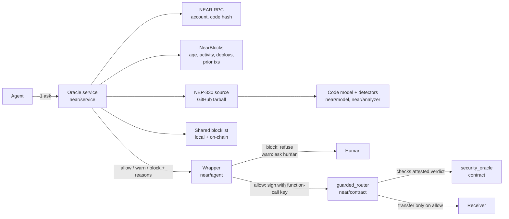

# NEAR Security Oracle

NEAR Hackathon, track 06 "AI Security & Defense".

This is a counterparty check for AI agents that pay. Before an agent sends NEAR to an account or calls a contract, it
asks the oracle about the receiver. The oracle answers `allow`, `warn` or `block` and lists its reasons. The verdict
combines:

- a model trained on NEAR Rust smart-contract code, which scores the receiver's contract source;
- 29 rule detectors for NEAR bug classes;
- account signals: age, activity, recent code changes, prior interactions;
- a shared blocklist that other agents can report to, with evidence attached.

On top of the service sit three pieces:

1. **Agent-side wrapper.** It refuses to sign on `block` and asks a human on `warn`.
2. **On-chain guarded router.** The agent's function-call key can only call this router, and the router pays out only
   on an `allow` the oracle attested on chain. A prompt-injected agent that skips the wrapper is still stopped.
3. **Attack demo.** A prompt-injected agent tries to pay a known-bad account and is stopped three ways: by the wrapper, by the router, and by the key's
   permissions. The log is
   [`agent/attack_demo.log`](agent/attack_demo.log).



## Try it: do X, see Y

**Before you start, install:**
- `git-lfs`
- [`uv`](https://docs.astral.sh/uv/)
- Rust via `rustup`. `near/contract/rust-toolchain.toml` pins 1.95.0 plus the wasm target, and rustup installs it
  on first use.
- Node 22 or newer, for the agent.

Steps 1–5 need only Python. Steps 1 and 5 need internet.

1. **Get the frozen models and data.** Run this from the repo root:
   ```bash
   git lfs pull --include "archives/near_models.zip,archives/near_datasets.zip"
   unzip -o archives/near_models.zip && unzip -o archives/near_datasets.zip
   uv sync
   ```
   **You see** `near/models/frozen_near_v1.pkl`, `frozen_near_v2.pkl` and `near/data/train_v2.jsonl`.
   The pull fetches only the NEAR archives; plain `git lfs pull` would also fetch the 1.6 GB EVM models.

   The LLM part of v2 is optional, about 0.9 GB. Get it with `git lfs pull --include archives/near_llm_v2.zip &&
   unzip -o archives/near_llm_v2.zip`. Without it the service serves the v1 model.

2. **Run the Python tests.**
   ```bash
   uv run python -m unittest discover -s near -t . -p 'test_*.py'
   ```
   **You see** `Ran 295 tests ... OK`, or `OK (skipped=2)` if you did not unpack the optional v2 LLM. This covers the analyzer, collectors, split checks, model freeze and predict,
   policy and service.

3. **Start the oracle and open the demo.**
   ```bash
   uv run uvicorn near.service.app:app --port 8000
   ```
   Open <http://localhost:8000/>. **You see** the demo page. It has four sections:
   - check a receiver;
   - score contract code;
   - the attack-demo log;
   - the model's real numbers.

   `curl localhost:8000/v1/health` shows the model being served: `frozen_near_v1`, or `frozen_near_v2` if you
   unpacked the LLM.

4. **Score vulnerable vs fixed contract code.** In a second terminal:
   ```bash
   for f in vulnerable fixed; do
     python3 -c "import json,sys; print(json.dumps({'source_files': {'src/lib.rs': open(sys.argv[1]).read()}}))" \
       near/demo/examples/$f.rs | curl -s localhost:8000/v1/analyze -H 'content-type: application/json' -d @- \
       | python3 -c "import json,sys; r=json.load(sys.stdin); print(r['label'], r['risk'], [(t['fn'], [h['detector'] for h in t['detector_hits']]) for t in r['top'][:2]])"
   done
   ```
   **You see** the vulnerable contract flagged on `on_withdraw` with `non_private_callback` and
   `callback_ignores_result`:
   - v1: `medium 0.572`;
   - v2: `high 0.953`.

   The fixed contract scores `low` (v1 0.13, v2 0.72; v2 thresholds are 0.85 for warn and 0.93 for block).

5. **Ask about a live mainnet receiver.**
   ```bash
   curl -s localhost:8000/v1/check -H 'content-type: application/json' \
     -d '{"receiver_id": "wrap.near", "agent_id": "relay.aurora", "deposit_yocto": "1000000000000000000000000"}'
   ```
   **You see** a verdict with reasons and every signal, including where it came from. At the time of writing,
   `wrap.near` gets `warn`: it is a contract with no NEP-330 source metadata, so there is no source to score. Live data
   can change the answer.

6. **Run the on-chain contracts in a local NEAR sandbox.** These are real wasm files, with no mocks.
   ```bash
   cargo +1.95.0 install cargo-near --version 0.23.0 --locked   # once
   cd near/contract && cargo test
   ```
   **You see** 18 sandbox tests pass, for example:
   - non-attesters cannot submit verdicts;
   - the router refuses `block`, `warn`, missing or expired verdicts, and receivers blocked by a confirmed report;
   - verdicts from a removed attester stop counting, and a verdict cannot be set to expire more than 7 days ahead;
   - the router enforces a daily limit;
   - a failed transfer is rolled back.

   The first run downloads the sandbox binary and takes a few minutes.

7. **Run the agent wrapper tests and the prompt-injection attack demo.** This needs step 6's sandbox binary and wasm.
   ```bash
   cd near/agent && npm install && npm test && npm run demo
   ```
   **You see** 19 unit tests pass, then the demo ends with `== 12/12 checks passed ==`. It rewrites
   `near/agent/attack_demo.log`. In the log the injected agent's payment to `drainer.test.near` is stopped three times:
   - (1) the wrapper refuses on `block`;
   - (3) bypassing the wrapper, the router refuses on chain;
   - (4) a direct transfer with the function-call key fails with `RequiresFullAccess`.

   Separately, a `warn` waits for a human, who declines.

8. **Optional: run the rule detectors on any Rust code.**
   ```bash
   uv run python -m near.analyzer near/demo/examples/vulnerable.rs
   ```

## The model, honestly

The model scores each public contract function. A contract's risk is the maximum over its functions. Thresholds are
set at 1% (`high`) and 5% (`medium`) false alarms on known-safe contract functions. Recall below is per vulnerable
function. Every test number comes from repositories left out of the training data. v2's base LLM, Qwen2.5-Coder, was
pretrained on public code and may have seen older test repos; test audits and hacks from 2025 on came after its
release.

| | v1 (sealed test, scored once) | v2 vs v1 on the cleaned test (development-informed) |
|---|---|---|
| Real bugs flagged `high` | **18/215 = 8.4%** [5.4, 12.8] | 6/139 vs 6/139 |
| Real bugs flagged `medium` or `high` | **42/215 = 19.5%** [14.8, 25.3] | 29/139 = 20.9% vs 22/139 = 15.8% (not significant) |
| False alarms on contract code, `high` / `medium` | 0.9% / 5.2% | 1.2% / 5.9% vs 0.9% / 5.2% |
| Already-fixed versions flagged `high` | 4.0% | 0.9% vs 4.4% (not significant) |
| Held-out hacks | 0 blocked, 3 warned, 10 missed of 13 | 0 / 2 / 9 of 11 vs 0 / 3 / 8 |
| Injected bugs (mutations) flagged `high` | 30.7% | 42.5% vs 30.7% |

The models:
- **v1:** gradient-boosted trees on detector and structure features plus code tokens.
- **v2:** a mean-rank ensemble of two parts. One is a classical model that also reads the function's file and its
  Cargo.toml. The other is Qwen2.5-Coder-0.5B, fine-tuned with LoRA and a pairwise loss (vulnerable vs fixed).

Model selection used nested grouped CV on the training set only. Each model was frozen with sha256 hashes of its
code, training rows and checkpoint; the loader refuses a changed file. Full logs are in
[`model/reports/RESULTS.md`](model/reports/RESULTS.md).

**What the numbers mean:**
- The models learn what kind of code tends to be risky, not the specific bug. Ranking a vulnerable function above its
  own fix is at chance once code length is controlled.
- v2 is not measurably better than v1: no test difference between them is statistically significant (27 repo
  groups; every bootstrap interval includes 0). It flags fewer already-fixed versions (1/113 vs 5/113) and more
  injected-bug mutations.
- So a model score alone only warns. `block` needs one of:
  - the shared blocklist;
  - an on-chain attestation;
  - high code risk that a high-severity detector agrees with on the same function.
- Most real exploits are logic bugs that need the surrounding protocol to understand. Treat code risk as a warning
  signal, and keep the router's limits as the real backstop.

## Signals and where they come from

| Signal | Source | How |
|---|---|---|
| exists, contract or not, code hash, balance | NEAR JSON-RPC (FastNEAR, then near.org) | `query view_account` |
| account age, activity count | NearBlocks API | `/v3/accounts/{id}/stats` (first active day); `/v3/accounts/{id}` creation record if no activity |
| code changed recently | NearBlocks | latest entry of `/v3/accounts/{id}/contract/deployments` |
| prior interactions agent → receiver | NearBlocks | `/v3/accounts/{agent}/txns?receiver={id}` |
| contract source | NEP-330 `contract_source_metadata` view | repo and commit, then GitHub tarball (in memory, size-capped, `.rs` and `Cargo.toml` only); or caller-supplied, which only warns |
| code risk | `near/model/predict.py` | frozen model plus detectors; detectors only if no model is present |
| shared blocklist | local store and on-chain `security_oracle` | `POST /v1/report` with an evidence URL (sha256 optional); the operator or attesters confirm; `is_blocked` view |
| on-chain attestation | `security_oracle.get_verdict` | verdict, code hash, expiry |

A signal that could not be read is a reason to warn, never a pass. Policy thresholds (account age, recent code
change, large deposit, detectors-only fallback) are in [`service/policy.py`](service/policy.py). The model's
high/medium thresholds are frozen in `models/frozen_near_v1.json` and `models/frozen_near_v2.json`.

## Function-call access key: what it limits

The agent holds only a function-call access key for `guarded_router`, never a full-access key. Details are in
[`agent/README.md`](agent/README.md#function-call-access-key-limits).

What the key cannot do:
- call any method other than the listed ones, on any contract other than the router;
- attach a deposit;
- transfer NEAR;
- add or delete keys;
- deploy code.

Its gas allowance runs out, and an account holding only such keys cannot refill it or add a key. In the demo the
agent's full-access key is deleted, so an exhausted or leaked key cannot be replaced. The human still controls the
funds through the router (owner-only `withdraw`) and can register a new agent account.

The router adds what the key alone cannot:
- an oracle check on every payment;
- a per-agent daily limit;
- a transfer that happens only in a `#[private]` callback after an unexpired `allow` for the receiver, attested by a
  current attester.

The router cannot read the receiver's code hash on chain. A redeploy is caught by the off-chain service, which warns
when the attested code hash differs, or when the attestation expires (at most 7 days, 1 hour in the relay).

## Data

| | Train (`train_v2`) | Test (`test_v1c`) |
|---|---|---|
| Functions | 66,590 | 7,473 |
| Real vulnerable functions | 498: 144 from audits, 352 from fix commits, 2 from hacks | 169: 112 from audits, 45 from fix commits, 12 from hacks |
| Repositories with a real bug | 151 | 27 |
| Injected-bug mutations / their originals | 8,275 / 5,986 | 1,539 / 1,080 |
| Corpus functions, presumed safe | 51,410 from 2,146 repo groups (2,798 repos cloned) | 4,567 |

Sources:
- audit reports from 19 auditors: NEARBuilders/audits plus newer public reports;
- 22 NEAR hacks and incidents from 2021 to 2026, for example Ref Finance, Aurora Engine, Rainbow Bridge, Meta Pool
  mpETH, SWEAT and NEAR Intents;
- security-fix commits mined from NEAR repos, each diff read and triaged;
- function-level mutations from 14 NEAR-specific operators.

How the split was made:
- Repositories, merged with their copies, sit wholly in train or wholly in test.
- Every audit or hack dated 2025 or later is in test.
- Leakage is checked on id, group and normalized-code hash.

Most hacks sit in the test set. The split puts recent incidents there, so the 2 hack-derived training rows are not a
mistake.

The 758 real labels of the first dataset were re-checked blind to model scores, and 40% were dropped: informational
findings, wrong function, or not a bug. The 209 fix-commit positives added for v2 were triaged once, when mined.

`archives/near_datasets.zip` holds the samples, splits, findings, incidents and relabel notes. It also holds the
per-report extraction scripts that turned audit PDFs into finding rows (`near/data/raw/audits/**/*.py`). It leaves out
the cloned repos and the audit PDFs and their text, which are third-party; finding rows carry their source URLs
instead.

## Layout

| Path | What |
|---|---|
| `analyzer/` | tree-sitter Rust function extraction, 29 NEAR detectors, features |
| `collect/` | audits, incidents, corpus, fix-commit mining, mutations, split assembly |
| `model/` | training, nested CV, freeze, sealed scoring, `predict.py`; `reports/` holds the results |
| `service/` | FastAPI oracle: `/v1/check`, `/v1/analyze`, `/v1/report`, `/v1/health`, `/demo/` |
| `contract/` | near-sdk 5.30 contracts `security_oracle` and `guarded_router`, near-workspaces sandbox tests |
| `agent/` | wrapper, attester relay, simulated agent, attack demo and its log |
| `demo/` | the browser demo (`index.html`) and the two example contracts |
| `PLAN.md` | the build spec the parts were written against |

Service configuration (environment variables):
- `NEAR_NETWORK`: `mainnet`, `testnet` or `sandbox`;
- `NEAR_RPC_URL`;
- `ORACLE_CONTRACT_ID`: the on-chain oracle to read;
- `NEARBLOCKS_API_KEY`: optional; the free tier is about 6 requests a minute;
- `ORACLE_BLOCKLIST_PATH`;
- `ORACLE_ADMIN_TOKEN`: needed to confirm reports through the API;
- `NEAR_ORACLE_MODEL`: `frozen_near_v1` or `frozen_near_v2`.

## Limits

- **Not audited.** The contracts are tested only on the local sandbox; there is no testnet or mainnet deployment yet.
- **Low code-model recall.** The model labels about 1 real bug in 12 `high` (v1, sealed test), about 1 in 20 on the
  cleaned test (v1 and v2), and about 1 in 5 `medium` or `high`. A `high` label blocks only when a high-severity rule
  agrees on the same function, so the oracle blocks fewer than that from code alone. It is a signal, not a proof of
  safety.
- **Source is self-declared.** The oracle scores the repo and commit named in the contract's NEP-330 metadata. It does
  not rebuild the source or compare it with the deployed code hash, so a contract can point at source it does not run.
- **Unauthenticated reports.** Anyone who can reach `POST /v1/report` can file a pending report, which makes
  `/v1/check` warn for that receiver until an operator dismisses it (`python -m near.service.blocklist dismiss ID`). Run the
  service on a private network or add authentication and rate limits before exposing it.
- **NearBlocks free tier.** It rate-limits; set `NEARBLOCKS_API_KEY` for real use.
- **Unverifiable source.** Contracts without NEP-330 metadata get `warn`.
- **Development-informed v2 test.** v2's test numbers are development-informed: v1's results on the same test were
  seen before v2 was built. A fresh sealed test is still needed.

## Disclosure

- **Pre-hackathon code.** The EVM security oracle in the rest of this repository (`oracle/`, `scripts/`,
  `contracts/`, `runs/`) predates the hackathon. It was first committed 2026-10-15. The NEAR work reuses its method
  (grouped CV, freeze with hashes, sealed test scored once) but none of its code paths. Everything under `near/` was
  built during the hackathon.
- **AI-generated code.** Most code, data tooling and documentation under `near/` was written by AI coding agents
  (Claude Code), directed and reviewed by the author. The label re-check and fix-commit triage were also done by AI
  agents reading each case, with notes in `archives/near_datasets.zip` (`near/data/relabel/`,
  `near/data/raw/fix_commit_triage*/`).

License: [Business Source License 1.1](../LICENSE).
