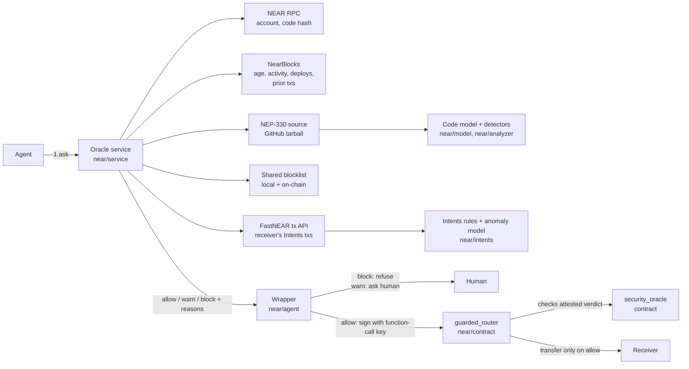

# NEAR Security Oracle

NEAR Hackathon, track 06 "AI Security & Defense".

This is a counterparty check for AI agents that pay. Before an agent sends NEAR to an account or calls a contract, it
asks the oracle about the receiver. The oracle answers `allow`, `warn` or `block` and lists its reasons. The verdict
combines:

- a model trained on NEAR Rust smart-contract code, which scores the receiver's contract source;
- 29 rule detectors for NEAR bug classes;
- account signals: age, activity, recent code changes, prior interactions;
- a shared blocklist that other agents can report to, with evidence attached;
- a NEAR Intents transaction detector: the receiver's recent `intents.near` transactions, scored by invariant rules
  plus an anomaly model trained on normal Intents traffic (see
  [NEAR Intents transaction anomaly detector](#near-intents-transaction-anomaly-detector)).

On top of the service sit three pieces:

1. **Agent-side wrapper.** It refuses to sign on `block` and asks a human on `warn`.
2. **On-chain guarded router.** The agent's function-call key can only call this router, and the router pays out only
   on an `allow` the oracle attested on chain. A prompt-injected agent that skips the wrapper is still stopped.
3. **Attack demo.** A prompt-injected agent tries to pay a known-bad account and is stopped three ways: by the wrapper, by the router, and by the key's
   permissions. The log is
   [`agent/attack_demo.log`](agent/attack_demo.log).



## Try it: do X, see Y

**Before you start, install:**
- `git-lfs`
- [`uv`](https://docs.astral.sh/uv/)
- Rust via `rustup`. `near/contract/rust-toolchain.toml` pins 1.95.0 plus the wasm target, and rustup installs it
  on first use.
- Node 22 or newer, for the agent.

Steps 1–5 need only Python. Steps 1 and 5 need internet.

1. **Get the frozen models and data.** Run this from the repo root:
   ```bash
   git lfs pull --include "archives/near_models.zip,archives/near_datasets.zip,archives/near_intents.zip"
   unzip -o archives/near_models.zip && unzip -o archives/near_datasets.zip && unzip -o archives/near_intents.zip
   uv sync
   ```
   **You see** `near/models/frozen_near_v1.pkl`, `frozen_near_v2.pkl`, `near/data/train_v2.jsonl` and the frozen
   NEAR Intents model `near/models/intents_v1.{pkl,json,train_ids.json}`.
   The pull fetches only the NEAR archives; plain `git lfs pull` would also fetch the 1.6 GB EVM models.
   Without `near_intents.zip`, `/v1/intents/score` returns 503 and 10 NEAR Intents service tests are skipped.

   The LLM part of v2 is optional, about 0.9 GB. Get it with `git lfs pull --include archives/near_llm_v2.zip &&
   unzip -o archives/near_llm_v2.zip`. Without it the service serves the v1 model.

2. **Run the Python tests.**
   ```bash
   uv run python -m unittest discover -s near -t . -p 'test_*.py'
   ```
   **You see** `Ran 412 tests ... OK (skipped=2)`. The 2 skipped tests replay the Intents exploit in a NEAR sandbox
   and run only with `INTENTS_SANDBOX_E2E=1`. Tests that need an optional artifact are also skipped without it: 2
   without the v2 LLM, 10 without the NEAR Intents model (`near/models/intents_v1.*`). This covers the analyzer,
   collectors, split checks, model freeze and predict, policy and service, and the NEAR Intents collector, features
   and rules, model, evaluation, supervised head and synthetic sandbox scenarios.

3. **Start the oracle and open the demo.**
   ```bash
   uv run uvicorn near.service.app:app --port 8000
   ```
   Open <http://localhost:8000/>. **You see** the demo page. It has five sections:
   - check a receiver;
   - score contract code;
   - score a NEAR Intents transaction (needs `near/models/intents_v1.*`, see
     [below](#near-intents-transaction-anomaly-detector));
   - the attack-demo log;
   - the model's real numbers.

   `curl localhost:8000/v1/health` shows the model being served: `frozen_near_v1`, or `frozen_near_v2` if you
   unpacked the LLM.

4. **Score vulnerable vs fixed contract code.** In a second terminal:
   ```bash
   for f in vulnerable fixed; do
     python3 -c "import json,sys; print(json.dumps({'source_files': {'src/lib.rs': open(sys.argv[1]).read()}}))" \
       near/demo/examples/$f.rs | curl -s localhost:8000/v1/analyze -H 'content-type: application/json' -d @- \
       | python3 -c "import json,sys; r=json.load(sys.stdin); print(r['label'], r['risk'], [(t['fn'], [h['detector'] for h in t['detector_hits']]) for t in r['top'][:2]])"
   done
   ```
   **You see** the vulnerable contract flagged on `on_withdraw` with `non_private_callback` and
   `callback_ignores_result`:
   - v1: `medium 0.572`;
   - v2: `high 0.953`.

   The fixed contract scores `low` (v1 0.13, v2 0.72; v2 thresholds are 0.85 for warn and 0.93 for block).

5. **Ask about a live mainnet receiver.**
   ```bash
   curl -s localhost:8000/v1/check -H 'content-type: application/json' \
     -d '{"receiver_id": "wrap.near", "agent_id": "relay.aurora", "deposit_yocto": "1000000000000000000000000"}'
   ```
   **You see** a verdict with reasons and every signal, including where it came from. At the time of writing,
   `wrap.near` gets `warn`: it is a contract with no NEP-330 source metadata, so there is no source to score. Live data
   can change the answer.

6. **Run the on-chain contracts in a local NEAR sandbox.** These are real wasm files, with no mocks.
   ```bash
   cargo +1.95.0 install cargo-near --version 0.23.0 --locked   # once
   cd near/contract && cargo test
   ```
   **You see** 18 sandbox tests pass, for example:
   - non-attesters cannot submit verdicts;
   - the router refuses `block`, `warn`, missing or expired verdicts, and receivers blocked by a confirmed report;
   - verdicts from a removed attester stop counting, and a verdict cannot be set to expire more than 7 days ahead;
   - the router enforces a daily limit;
   - a failed transfer is rolled back.

   The first run downloads the sandbox binary and takes a few minutes.

7. **Run the agent wrapper tests and the prompt-injection attack demo.** This needs step 6's sandbox binary and wasm.
   ```bash
   cd near/agent && npm install && npm test && npm run demo
   ```
   **You see** 19 unit tests pass, then the demo ends with `== 12/12 checks passed ==`. It rewrites
   `near/agent/attack_demo.log`. In the log the injected agent's payment to `drainer.test.near` is stopped three times:
   - (1) the wrapper refuses on `block`;
   - (3) bypassing the wrapper, the router refuses on chain;
   - (4) a direct transfer with the function-call key fails with `RequiresFullAccess`.

   Separately, a `warn` waits for a human, who declines.

8. **Optional: run the rule detectors on any Rust code.**
   ```bash
   uv run python -m near.analyzer near/demo/examples/vulnerable.rs
   ```

## The model, honestly

The model scores each public contract function. A contract's risk is the maximum over its functions. Thresholds are
set at 1% (`high`) and 5% (`medium`) false alarms on known-safe contract functions. Recall below is per vulnerable
function. Every test number comes from repositories left out of the training data. v2's base LLM, Qwen2.5-Coder, was
pretrained on public code and may have seen older test repos; test audits and hacks from 2025 on came after its
release.

| | v1 (sealed test, scored once) | v2 vs v1 on the cleaned test (development-informed) |
|---|---|---|
| Real bugs flagged `high` | **18/215 = 8.4%** [5.4, 12.8] | 6/139 vs 6/139 |
| Real bugs flagged `medium` or `high` | **42/215 = 19.5%** [14.8, 25.3] | 29/139 = 20.9% vs 22/139 = 15.8% (not significant) |
| False alarms on contract code, `high` / `medium` | 0.9% / 5.2% | 1.2% / 5.9% vs 0.9% / 5.2% |
| Already-fixed versions flagged `high` | 4.0% | 0.9% vs 4.4% (not significant) |
| Held-out hacks | 0 blocked, 3 warned, 10 missed of 13 | 0 / 2 / 9 of 11 vs 0 / 3 / 8 |
| Injected bugs (mutations) flagged `high` | 30.7% | 42.5% vs 30.7% |

The models:
- **v1:** gradient-boosted trees on detector and structure features plus code tokens.
- **v2:** a mean-rank ensemble of two parts. One is a classical model that also reads the function's file and its
  Cargo.toml. The other is Qwen2.5-Coder-0.5B, fine-tuned with LoRA and a pairwise loss (vulnerable vs fixed).

Model selection used nested grouped CV on the training set only. Each model was frozen with sha256 hashes of its
code, training rows and checkpoint; the loader refuses a changed file. Full logs are in
[`model/reports/RESULTS.md`](model/reports/RESULTS.md).

**What the numbers mean:**
- The models learn what kind of code tends to be risky, not the specific bug. Ranking a vulnerable function above its
  own fix is at chance once code length is controlled.
- v2 is not measurably better than v1: no test difference between them is statistically significant (27 repo
  groups; every bootstrap interval includes 0). It flags fewer already-fixed versions (1/113 vs 5/113) and more
  injected-bug mutations.
- So a model score alone only warns. `block` needs one of:
  - the shared blocklist;
  - an on-chain attestation;
  - high code risk that a high-severity detector agrees with on the same function.
- Most real exploits are logic bugs that need the surrounding protocol to understand. Treat code risk as a warning
  signal, and keep the router's limits as the real backstop.

## NEAR Intents transaction anomaly detector

A transaction-level detector for NEAR Intents (`intents.near`). It flags transactions whose receipt graph looks like
an attack, and it feeds the `intents_activity` signal of `/v1/check`. It is separate from the code-risk model above.
Full write-up: [`intents/reports/RESULTS.md`](intents/reports/RESULTS.md); build spec:
[`intents/PLAN.md`](intents/PLAN.md).

**Why anomaly detection, not an exploit classifier.** Real attacks on NEAR Intents are few and come from about 5
actors. Of 570 labelled transactions, 23 are exploit transactions (strong positives, all from the 2026-10-01 incident)
and 414 are attempts (weak positives: the April out-of-gas callback attempts and the May token-spoof and admin-method
fuzzing). A classifier trained on them would learn those actors' fingerprints. So the detector learns what normal
looks like, scores transactions with interpretable invariant rules plus an anomaly model, and holds every real
campaign out as a case study.

**Data** (FastNEAR Transactions API, collected by `near.intents.collect`):
- 100,098 normal intents.near transactions, Nov 2024 to Nov 2026, sampled by month, including those that start on
  other contracts (HOT Omni, PoA bridge deposits). Split by time: train 69,863 (2024-11 to 2026-05), calibration
  17,772 (2026-06 to 2026-09), sealed test 12,463 (2026-10 to 2026-11).
- Of the sealed test, 7,400 rows were sampled by the collector and 5,063 are scouting seeds (transactions pulled
  around the exploit window and recent blocks). Rule development measured false alarms on the seeds, so the 7,400
  collector rows are the clean false-alarm estimate.
- 570 labelled transactions: 23 exploit, 414 attempt, 77 setup, 38 cashout, 1 setup funding (attacker-cluster
  transactions of ordinary shape, reported separately), and 17 team regression tests (negatives).
- No labelled transaction is used for training, model selection or thresholds.

**Features and rules** (`near.intents.features`). 63 environment-invariant features of the receipt graph: structure,
counts, method categories, event mix, relative amounts on a log scale. No account names, heights, timestamps or
absolute gas. 12 invariant rules, for example: a `*_resolve_*` callback failed (`failed_resolve_callback`), a log near
the 16 KB limit (`log_limit`), credit kept while the token refunded the sender (`credit_kept`), a refund larger than
the deposit, a Notify receiver inside a deposit, a private or admin method called directly, out-of-gas in a callback.

**Model** (`near.intents.model`). An IsolationForest on the features, trained on normals only. Label: `high` if a
high rule fires or the anomaly score reaches the high threshold, `medium` likewise, else `low`. Thresholds were set on
the calibration months for at most 1/10,000 (`high`) and 1/1,000 (`medium`) alerts on normal transactions. Frozen as
`near/models/intents_v1.{pkl,json}` with sha256 of the pkl, the feature and model code, and the training ids.
In practice `high` comes from the high-severity rules: the anomaly model never produced a `high` on calibration, test
or campaign data (only on 1 of the 69,863 train-month normals it was fitted on).

**Campaign case studies** (held out from training and calibration, but development-informed: see below):

| campaign / role | n | high / medium / missed |
|---|---|---|
| 2026-10-01 exploit / exploit | 23 | **23 / 0 / 0**: one technique repeated by one actor, effectively one sample |
| 2026-10-01 exploit / setup, cashout | 14, 38 | 0 / 0 / all (ordinary shape, not counted as misses) |
| April out-of-gas attempts | 55 | 0 / 53 / 2 (96.4% medium or above) |
| May token-spoof attempts | 182 | 0 / 18 / 164 (9.9%) |
| May admin-method fuzzing | 177 | 0 / 110 / 67 (62.1%) |
| team regression tests (negatives) | 17 | 0 / 12 / 5: **12 false alarms** at medium |

**False alarms on the sealed test normals** (scored after the freeze; Wilson 95% intervals):

| sealed test normals | rules only, `medium` or above | combined, `medium` or above | combined, `high` |
|---|---|---|---|
| **collector rows (clean estimate)** | **0/7,400** (0 to 0.052%) | **84/7,400 = 1.14%** (0.92 to 1.40) | 0/7,400 |
| collector rows without the 99 paused-contract txs (post hoc) | 0/7,301 | 4/7,301 = 0.055% (0.021 to 0.141) | 0/7,301 |
| all rows, including the 5,063 scouting seeds | 0/12,463 | 85/12,463 = 0.68% (0.55 to 0.84) | 0/12,463 (0 to 0.031%) |

**Alerts per day:** about **39 medium alerts a day** as a baseline (17 to 92; 53 a day on the collector rows alone),
plus a burst whenever intents.near is paused, and no `high` (upper bound 30 a day). The baseline is 5/12,364 test
normals outside the 99 paused-contract transactions, at 97,000 Intents transactions a day. That split is post hoc,
and 97,000 is the planning figure in `intents/PLAN.md`; FastNEAR's monthly count gives 86.8k a day for 2026-10.

What the numbers mean:
- **The rules do the detecting.** At medium and above, rules plus anomaly model flag exactly the same campaign
  transactions as rules alone. The anomaly model detected no attack that the rules missed. On its own it catches the
  October exploit at medium only, and that catch comes from 11 features that mirror the rules: set to their
  train-normal medians, 0/23 exploit transactions reach medium. Its value against unseen attacks is not demonstrated.
- **The medium target (1/1,000) is missed on the sealed test**: 1.14% on the collector rows, all from the anomaly
  model. 80 of the 84 alerts came from one hour, 2026-10-01 10:00 UTC, when intents.near was paused during the
  exploit response and bridge deposits failed with "Pausable: Method is paused". 80 of the 99 paused-contract
  deposits sampled alerted. The exclusion check was done after seeing the numbers.
- **So the oracle acts only on `high`.** In `/v1/check`, a recent Intents transaction of the receiver at `high`
  warns, naming the transaction and the rules; `medium` is listed as info and does not change the verdict.
- **Development-informed case studies.** The rules were written after seeing the October exploit and measuring the
  April and May campaigns, so 23/23 and the April and May numbers are not out-of-sample estimates.
- An optional supervised head trained on sandbox-generated attacks was built and **not adopted**: it added no real
  detections and would have raised the 80 paused-deposit normals to `high`.

### Try it: score the October exploit and a normal transaction

Needs `near/models/intents_v1.{pkl,json}` and `intents_v1.train_ids.json` from `archives/near_intents.zip` (Try it,
step 1) and internet (FastNEAR, mainnet).

1. **Start the oracle** (Try it, step 3): `uv run uvicorn near.service.app:app --port 8000`.
2. **Score one of the 23 exploit transactions of the 2026-10-01 incident.**
   ```bash
   curl -s localhost:8000/v1/intents/score -H 'content-type: application/json' \
     -d '{"tx_hash": "3k91uDpUiezxUe7hBgAR7kc3TBkToMZKGAiv6GqbtKiC"}' \
     | python3 -c "import json,sys; r=json.load(sys.stdin); print(r['label'], r['risk'], r['flow_type'], [h['rule'] for h in r['rule_hits']])"
   ```
   **You see** `high 1.0 deposit ['failed_resolve_callback', 'log_limit', 'credit_kept', 'refund_exceeds_deposit',
   'notify_receiver_in_deposit', 'many_token_ids']`.
3. **Score a normal transaction**, a PoA bridge deposit from 2026-11: run the same command with
   `"tx_hash": "8tTzvGLMV7x1swmF2A5m3zDugCimdwmDrTXDTvKsJvj"`. **You see** `low 0.647009 deposit []`.
4. **Check the exploiter's account as a receiver.**
   ```bash
   curl -s localhost:8000/v1/check -H 'content-type: application/json' \
     -d '{"receiver_id": "20e6bfe4685d99004fc2095d3a0fc6158cd810ce8f801196141e183ed6e19d65"}' \
     | python3 -c "import json,sys; r=json.load(sys.stdin); print(r['verdict']); print(*r['reasons'], sep='\n')"
   ```
   **You see**, at the time of writing (2026-11-14), `warn` with the reason `10 of the receiver's 20 most recent
   NEAR Intents transactions scored high:
   GAQKwHdT... (failed_resolve_callback, ...)`. It warns and does not block: the Intents signal never blocks on its
   own.
5. **In the browser**, the demo's "Score a NEAR Intents transaction" card has both transactions as presets.

`POST /v1/intents/score {tx_hash, sender_id?}` returns `{risk, label, rule_hits, flow_type, top_features,
anomaly_score, anomaly_percentile, touches_intents, model: {version, sha256}}`, plus `sender_matches` when
`sender_id` is given. A malformed hash (not base58 of 32 bytes) is a 422, a hash FastNEAR does not know is a 404,
a FastNEAR failure is a 502 with the reason, FastNEAR not answering within 6 s is a 504 `FastNEAR did not answer
within 6 s` (the endpoint makes one FastNEAR request, so it answers within about 6 s), a fetched transaction the model
cannot score is a 502 `FastNEAR transaction could not be scored (<error type>)`, and a missing or changed intents
model is a 503. Use `label` for decisions: `risk` is max(rule weight, anomaly percentile), and an ordinary failing
`execute_intents` has risk around 0.96 and label `low`.

**`intents_activity` in `/v1/check`.** On mainnet the oracle reads the receiver's 40 newest FastNEAR account-index
rows, fetches those transactions in batches of 20 until it has the 20 most recent that touch `intents.near` (at most 3
requests, each ending within 6 s of wall-clock time however slowly FastNEAR sends, with answers over 8 MB refused),
and scores each one. A `high` transaction warns; `medium` is listed as info.
- **Unreadable warns, for every receiver.** If FastNEAR is down, answers any HTTP error (including a 429 rate limit),
  sends a body of the wrong shape, leaves out any of the requested transactions (`FastNEAR returned k of n
  transactions`), returns a transaction the model cannot score, or does not answer within 15 s of the check starting,
  the signal is unavailable and the check warns with `recent NEAR Intents activity of the receiver could not be read
  (<error>)`. The same happens when an Intents transaction is found but the intents model is missing. Why:
  FastNEAR's free quota (about 60 requests a minute) is shared by every check, and anyone can drain it through the
  unauthenticated endpoints. If "unreadable" passed, draining the quota would turn the warn on an
  exploiter's account into an allow. The cost is availability: while the quota is drained, every mainnet check warns.
- **Cache.** Successful reads are cached 5 minutes per receiver, for at most 1,024 receivers; the least recently read
  is evicted first. Failed reads are not cached.
- Off mainnet the signal is not applicable and changes nothing. The policy thresholds are in
  [`service/policy.py`](service/policy.py) (`intents_*`).

### Reproduce

The intents data (`near/data/intents/`) and model (`near/models/intents_v1.*`) are gitignored.
`archives/near_intents.zip` (Try it, step 1) holds the frozen model and the small data files: `labelled.jsonl.gz`,
`stats.json`, `windows.json` and the label file `all_labelled_txs.jsonl`. That is enough for `/v1/intents/score`,
`intents_activity` and the tests. It leaves out the normals (`normals.jsonl.gz`, 239 MB), the feature cache and the
synthetic data. To re-pull and rebuild (FastNEAR is free and keyless but allows about 60 requests a minute; the
collector paces at 1 request a second). The collector reads the archived label file and the attacker list in
`near/intents/fixtures/` by default. **`model freeze` overwrites the shipped `near/models/intents_v1.*`**: skip it to
keep the shipped model, or back those files up first.
```bash
uv run python -m near.intents.collect labelled   # 570 labelled txs, full receipts
uv run python -m near.intents.collect normals    # month-stratified sample, target 100,000 txs
uv run python -m near.intents.collect stats      # counts by month, flow type and outcome -> stats.json
uv run python -m near.intents.model cache        # features and rules for every tx (~15 s)
uv run python -m near.intents.model freeze       # fit, select, calibrate -> near/models/intents_v1.* (~3 s)
uv run python -m near.intents.evaluate tables    # re-render reports/evaluation.md from evaluation.json
```
A re-pull does not reproduce the exact sample: FastNEAR pages are drawn afresh and the scouting seeds are not in the
repository, so a refreeze gives a different model from `intents_v1`. The sealed test was already scored (`evaluate
run` refuses to rescore without `--rescore`).

**Limits.**
- Per-transaction only: setup, cashout and funding transactions of attackers look ordinary and are not flagged.
- Few campaigns (about 5 actors, 4 attack campaigns), so intervals are wide and the rates describe these actors. The
  23/23 on the exploit is one technique repeated by one actor.
- Rules alone flag 0.47% of training-period normals at medium (mostly `notify_receiver_in_deposit` in 2025-04 to
  2025-07), so quiet test months do not guarantee low rule false alarms.
- Calibration has no withdrawals and 227 "other" transactions; the high threshold rests on 17,772 rows.
- The pooled test numbers are partly in-sample for the rules: they were tuned for false alarms on the 5,063 scouting
  seeds in the test slice (and 2,672 in calibration). Use the collector rows.
- 4 train normals were signed by a `setup` account of both May campaigns that the attacker list did not name. The
  model was not refrozen; the collector now drops such signers on future pulls.
- **Evasion:** `intents_activity` reads only the receiver's 40 newest account-index rows. 40 unrelated transactions
  involving the receiver push an attack transaction out of that window, and the check no longer sees it.
- **Griefing:** any `high` transaction the receiver merely appears in counts against it; its role (signer, notified
  contract, counterparty) is not checked. So a third party can make an account warn by involving it in a transaction
  that scores `high`.

## Signals and where they come from

| Signal | Source | How |
|---|---|---|
| exists, contract or not, code hash, balance | NEAR JSON-RPC (FastNEAR, then near.org) | `query view_account` |
| account age, activity count | NearBlocks API | `/v3/accounts/{id}/stats` (first active day); `/v3/accounts/{id}` creation record if no activity |
| code changed recently | NearBlocks | latest entry of `/v3/accounts/{id}/contract/deployments` |
| prior interactions agent → receiver | NearBlocks | `/v3/accounts/{agent}/txns?receiver={id}` |
| contract source | NEP-330 `contract_source_metadata` view | repo and commit, then GitHub tarball (in memory, size-capped, `.rs` and `Cargo.toml` only); or caller-supplied, which only warns |
| code risk | `near/model/predict.py` | frozen model plus detectors; detectors only if no model is present |
| shared blocklist | local store and on-chain `security_oracle` | `POST /v1/report` with an evidence URL (sha256 optional); the operator or attesters confirm; `is_blocked` view |
| on-chain attestation | `security_oracle.get_verdict` | verdict, code hash, expiry |
| NEAR Intents activity (mainnet only) | FastNEAR Transactions API + `near/models/intents_v1` | receiver's 40 latest index rows, then full txs in batches of 20 until 20 that touch `intents.near` (at most 3 requests, each ending within 6 s, answers over 8 MB refused; `/v1/check` waits at most 15 s), each scored; unreadable or partial reads warn for every receiver; successful reads cached 5 minutes per receiver, at most 1,024 receivers, least recently read evicted first |

A signal that could not be read is a reason to warn, never a pass. Policy thresholds (account age, recent code
change, large deposit, detectors-only fallback) are in [`service/policy.py`](service/policy.py). The model's
high/medium thresholds are frozen in `models/frozen_near_v1.json` and `models/frozen_near_v2.json`.

## Function-call access key: what it limits

The agent holds only a function-call access key for `guarded_router`, never a full-access key. Details are in
[`agent/README.md`](agent/README.md#function-call-access-key-limits).

What the key cannot do:
- call any method other than the listed ones, on any contract other than the router;
- attach a deposit;
- transfer NEAR;
- add or delete keys;
- deploy code.

Its gas allowance runs out, and an account holding only such keys cannot refill it or add a key. In the demo the
agent's full-access key is deleted, so an exhausted or leaked key cannot be replaced. The human still controls the
funds through the router (owner-only `withdraw`) and can register a new agent account.

The router adds what the key alone cannot:
- an oracle check on every payment;
- a per-agent daily limit;
- a transfer that happens only in a `#[private]` callback after an unexpired `allow` for the receiver, attested by a
  current attester.

The router cannot read the receiver's code hash on chain. A redeploy is caught by the off-chain service, which warns
when the attested code hash differs, or when the attestation expires (at most 7 days, 1 hour in the relay).

## Data

| | Train (`train_v2`) | Test (`test_v1c`) |
|---|---|---|
| Functions | 66,590 | 7,473 |
| Real vulnerable functions | 498: 144 from audits, 352 from fix commits, 2 from hacks | 169: 112 from audits, 45 from fix commits, 12 from hacks |
| Repositories with a real bug | 151 | 27 |
| Injected-bug mutations / their originals | 8,275 / 5,986 | 1,539 / 1,080 |
| Corpus functions, presumed safe | 51,410 from 2,146 repo groups (2,798 repos cloned) | 4,567 |

Sources:
- audit reports from 19 auditors: NEARBuilders/audits plus newer public reports;
- 22 NEAR hacks and incidents from 2021 to 2026, for example Ref Finance, Aurora Engine, Rainbow Bridge, Meta Pool
  mpETH, SWEAT and NEAR Intents;
- security-fix commits mined from NEAR repos, each diff read and triaged;
- function-level mutations from 14 NEAR-specific operators.

How the split was made:
- Repositories, merged with their copies, sit wholly in train or wholly in test.
- Every audit or hack dated 2025 or later is in test.
- Leakage is checked on id, group and normalized-code hash.

Most hacks sit in the test set. The split puts recent incidents there, so the 2 hack-derived training rows are not a
mistake.

The 758 real labels of the first dataset were re-checked blind to model scores, and 40% were dropped: informational
findings, wrong function, or not a bug. The 209 fix-commit positives added for v2 were triaged once, when mined.

`archives/near_datasets.zip` holds the samples, splits, findings, incidents and relabel notes. It also holds the
per-report extraction scripts that turned audit PDFs into finding rows (`near/data/raw/audits/**/*.py`). It leaves out
the cloned repos and the audit PDFs and their text, which are third-party; finding rows carry their source URLs
instead.

## Layout

| Path | What |
|---|---|
| `analyzer/` | tree-sitter Rust function extraction, 29 NEAR detectors, features |
| `collect/` | audits, incidents, corpus, fix-commit mining, mutations, split assembly |
| `model/` | training, nested CV, freeze, sealed scoring, `predict.py`; `reports/` holds the results |
| `service/` | FastAPI oracle: `/v1/check`, `/v1/analyze`, `/v1/report`, `/v1/intents/score`, `/v1/health`, `/demo/` |
| `intents/` | NEAR Intents transaction detector: FastNEAR collector, receipt-graph features and rules, anomaly model, evaluation; `intents/reports/RESULTS.md` |
| `contract/` | near-sdk 5.30 contracts `security_oracle` and `guarded_router`, near-workspaces sandbox tests |
| `agent/` | wrapper, attester relay, simulated agent, attack demo and its log |
| `demo/` | the browser demo (`index.html`) and the two example contracts |
| `PLAN.md` | the build spec the parts were written against |

Service configuration (environment variables):
- `NEAR_NETWORK`: `mainnet`, `testnet` or `sandbox`;
- `NEAR_RPC_URL`;
- `ORACLE_CONTRACT_ID`: the on-chain oracle to read;
- `NEARBLOCKS_API_KEY`: optional; the free tier is about 6 requests a minute;
- `ORACLE_BLOCKLIST_PATH`;
- `ORACLE_ADMIN_TOKEN`: needed to confirm reports through the API;
- `NEAR_ORACLE_MODEL`: `frozen_near_v1` or `frozen_near_v2`.

## Limits

- **Not audited.** The contracts are tested only on the local sandbox; there is no testnet or mainnet deployment yet.
- **Low code-model recall.** The model labels about 1 real bug in 12 `high` (v1, sealed test), about 1 in 20 on the
  cleaned test (v1 and v2), and about 1 in 5 `medium` or `high`. A `high` label blocks only when a high-severity rule
  agrees on the same function, so the oracle blocks fewer than that from code alone. It is a signal, not a proof of
  safety.
- **Source is self-declared.** The oracle scores the repo and commit named in the contract's NEP-330 metadata. It does
  not rebuild the source or compare it with the deployed code hash, so a contract can point at source it does not run.
- **Unauthenticated reports.** Anyone who can reach `POST /v1/report` can file a pending report, which makes
  `/v1/check` warn for that receiver until an operator dismisses it (`python -m near.service.blocklist dismiss ID`). Run the
  service on a private network or add authentication and rate limits before exposing it.
- **NearBlocks free tier.** It rate-limits; set `NEARBLOCKS_API_KEY` for real use.
- **FastNEAR free quota.** About 60 requests a minute, shared by every check, and any client can drain it. While it is
  drained, every mainnet `/v1/check` warns (the Intents signal fails closed). That is a nuisance, not a bypass.
- **Unverifiable source.** Contracts without NEP-330 metadata get `warn`.
- **Development-informed v2 test.** v2's test numbers are development-informed: v1's results on the same test were
  seen before v2 was built. A fresh sealed test is still needed.

## Disclosure

- **Pre-hackathon code.** The EVM security oracle in the rest of this repository (`oracle/`, `scripts/`,
  `contracts/`, `runs/`) predates the hackathon. It was first committed 2026-10-15. The NEAR work reuses its method
  (grouped CV, freeze with hashes, sealed test scored once) but none of its code paths. Everything under `near/` was
  built during the hackathon.
- **AI-generated code.** Most code, data tooling and documentation under `near/` was written by AI coding agents
  (Claude Code), directed and reviewed by the author. The label re-check and fix-commit triage were also done by AI
  agents reading each case, with notes in `archives/near_datasets.zip` (`near/data/relabel/`,
  `near/data/raw/fix_commit_triage*/`).
- **NEAR Intents detector.** The Intents detector (`intents/`, `service/intents.py`) was also written with AI coding
  agents (Claude Code) during the hackathon, like the rest of `near/`.

License: [Business Source License 1.1](../LICENSE).
