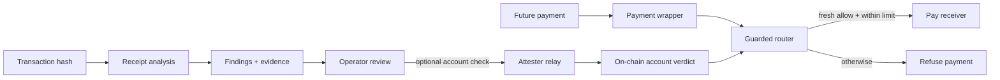

# Optional response adapters

The **Security Oracle** starts with a transaction hash: receipt rules produce findings for an operator
to investigate. These adapters are an optional next step for restricting **future payments** after review.
They do not analyze receipts, reverse a completed transaction, or pause a protocol.



**Transaction findings and account verdicts are different outputs.** The relay calls `/v1/check` for an account;
it does not turn `/v1/transactions/score` results into blocks. An operator must choose to invoke it with an authorized
attester key. Evidence reports and confirmations are separate [contract methods](../contract/README.md).

## Components

| Component | Purpose |
|---|---|
| [attester_relay.js](src/attester_relay.js) | Publishes an account verdict, evidence hash and expiry; default TTL 1 hour |
| [wrapper.js](src/wrapper.js) | `payWithOracle(...)` checks an account before signing a future router payment |
| [wrapper.js](src/wrapper.js) | `createRouterPaySigner(...)` verifies the key permits only the router's `pay` method |
| [simulated_agent.js](src/simulated_agent.js) | Optional deterministic invoice-injection fixture; not the protocol analysis flow |

The relay rejects malformed responses, wrong receivers, invalid scores and TTLs outside 1 second–7 days.
Configure the network, service, oracle account and operator credentials listed in its source, then run:

```bash
cd near/agent
node src/attester_relay.js receiver.near 3600
```

This command **writes an account attestation on chain** using the configured operator key.
A high-risk transaction alone never invokes this command or confirms a report.

## Verify the optional payment integration

Needs Node ≥ 22, `uv`, and the Python setup in the [run guide](../README.md).

```bash
# From the repository root:
(cd near/contract && cargo test)
cd near/agent
npm install
npm test
npm run demo
```

Expected: **35 unit/UI tests**, then **12/12 integration demo checks**. See [attack_demo.log](attack_demo.log).
The sandbox demo shows a merchant payment succeeding and a blocked destination refused by the wrapper, router,
and scoped key. Its invoice parser is scripted, **not an LLM**, and its block is confirmed by our own attester.
It does not demonstrate receipt detection. The Rust build supplies the compatible nearcore 2.14.1 sandbox;
the older npm sandbox cannot load these contracts.

## Payment and key limits

| Rule | Effect |
|---|---|
| Wrapper `block` | Refuses to sign |
| Wrapper `warn` | Asks a human; no response means decline |
| Router `warn`, expired or missing verdict | Refuses even after human approval in the wrapper |
| Function-call key | One contract, only `pay`, one function-call action, zero attached deposit |
| Key restrictions | Cannot directly transfer NEAR, manage keys, deploy code, stake, create or delete accounts |
| Finite gas allowance | Exhaustion stops signing; unlimited allowance exposes the account's gas balance |

Use decimal amount strings, e.g. `"0.1"`. Malformed or mismatched service answers block; service failures warn.
Only a full-access key or installed recovery mechanism can replace an exhausted or leaked key. An account with
only function-call keys cannot recover itself. The demo deletes the full-access key; recovery means a replacement
agent account. The human retains withdrawal control over router funds.

Attesters remain trusted. The router cannot compare the receiver's current code hash with the attested hash;
short expiries and re-attestation reduce this gap. See [contract limits](../contract/README.md).
