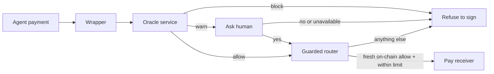

# Agent payment guard

The agent asks before paying. The wrapper checks the oracle; the router enforces the decision on chain.



Human approval does **not** override the router: an on-chain `warn` still refuses payment.

## Run the attack demo

Needs Node ≥ 22, `uv`, and the Python setup in the [run guide](../README.md).

```bash
# From the repository root; build the WASM and download the compatible sandbox:
(cd near/contract && cargo test)
cd near/agent
npm install
npm test
npm run demo
```

Expected: **28 unit tests**, then **12/12 demo checks**. The demo writes [attack_demo.log](attack_demo.log).
It uses nearcore 2.14.1 from the Rust build; the older npm sandbox binary cannot load these contracts.
To use another compatible binary (nearcore ≥ 2.13), set `NEAR_SANDBOX_BINARY_PATH` to its directory.

| Attempt | Result |
|---|---|
| Pay the merchant 2 NEAR | Paid |
| Invoice injection redirects funds to a blocked account | Wrapper refuses to sign |
| Skip wrapper and call the router directly | Router refuses; balance and allowance restored |
| Transfer directly using the agent key | Protocol rejects the action |
| Pay a receiver with a warning | Human declines; nothing signed |

The demo funds the router with 10 NEAR, caps spending at 5 NEAR/day, and gives the agent a 1 NEAR gas allowance.
The agent is a deterministic invoice parser, **not an LLM**. This tests enforcement after injection, not model
resistance. Local sandbox only; the bad account is blocked by our own attester. History signals and the code model
are not exercised by this demo.

## Integrate

| Component | Purpose |
|---|---|
| [wrapper.js](src/wrapper.js) | `payWithOracle({receiver, amount, reason}, deps)` checks before signing |
| [wrapper.js](src/wrapper.js) | `createRouterPaySigner(...)` verifies the key is restricted to the router's `pay` method |
| [attester_relay.js](src/attester_relay.js) | Publishes service verdicts, evidence hashes and expiry on chain; default TTL 1 hour |
| [simulated_agent.js](src/simulated_agent.js) | Reproducible prompt-injection fixture |

Pass amounts as decimal **strings**, e.g. `"0.1"`. Zero and values outside `u128` are rejected.
Supply `approve` for your human approval UI, or use `interactive: true` for a terminal prompt.
Without a human response, warnings are declined. Service failures warn; malformed or mismatched answers block.
The relay also rejects malformed responses, wrong receivers, invalid scores and TTLs outside 1 second–7 days.
See the [tests](test/wrapper.test.js) for runnable integration examples.

## What the function-call key permits

| Restriction | Why it matters |
|---|---|
| One contract, only `pay`, one function-call action per transaction | Cannot call other methods or contracts |
| Zero attached deposit | Cannot transfer NEAR directly or call methods requiring 1 yoctoNEAR |
| Cannot manage keys, deploy code, stake, create or delete accounts | Cannot grant itself full access |
| Finite gas allowance | Exhaustion stops signing; unlimited allowance exposes the account's gas balance |

Only a full-access key or an already-installed recovery mechanism can replace an exhausted or leaked key.
An account holding only function-call keys cannot recover itself. The demo deletes the full-access key;
recovery means creating a replacement agent account. The human can still withdraw the router's funds.
The key limits which method runs; **the router** limits what that method spends.

Attesters remain trusted. A receiver can redeploy after scoring: the router does not compare its current code hash
with the attested hash. Use short expiries and re-attest after changes. See [contract limits](../contract/README.md).
