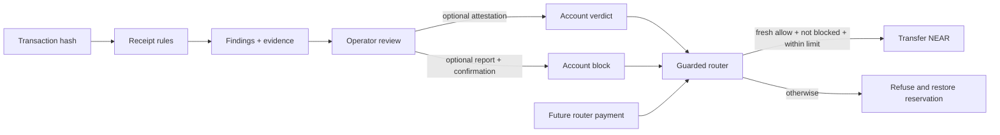

# Optional on-chain response layer

The **Protocol Security Agent** analyzes a transaction hash and returns receipt-rule findings for operator review.
These contracts optionally record **account-level** decisions and restrict **future payments through this router**.
They do not analyze receipts, revert completed transactions, or pause arbitrary protocols.



A detector finding does **not** automatically publish a verdict or confirm a report. An authorized operator must
choose a response. The [relay](../agent/src/attester_relay.js) publishes `/v1/check` account verdicts, not transaction
scores. Evidence reports are a separate workflow.

| Contract | Job |
|---|---|
| [security_oracle](security_oracle/src/lib.rs) | Trusted attesters publish account `allow / warn / block`; confirmed evidence reports override verdicts |
| [guarded_router](guarded_router/src/lib.rs) | Holds owner-funded balances and enforces account verdicts, expiry and spending limits on its payments |

## Build and verify

Needs Rust/rustup. [rust-toolchain.toml](rust-toolchain.toml) pins Rust 1.95.0 and the WASM target.

```bash
cargo +1.95.0 install cargo-near --version 0.23.0 --locked  # once
cd near/contract
cargo test
```

Expected: **18 tests passing**, using real WASM on a local NEAR sandbox. The first run downloads the sandbox
and compiles the contracts. Tests cover payments, refusals and refunds, access-key restrictions, spending limits,
private callbacks, evidence reports, expiry, and permanent attester revocation.

Build output: `target/near/{security_oracle,guarded_router}/*.wasm`.
The [adapter integration demo](../agent/README.md) exercises future-payment restrictions separately from detection.

## Main methods

Full signatures and validation live in the source files above; amounts use yoctoNEAR decimal strings.

| Contract / caller | Methods | Effect |
|---|---|---|
| Oracle / attester | `submit_verdict` | Publish account verdict, code hash, score, reasons hash and expiry; maximum TTL 7 days |
| Oracle / anyone | `report` | Attach evidence URL + SHA-256 and pay storage; pending reports alone do not block |
| Oracle / attester | `confirm_report`, `dismiss_report` | Confirm an account block or dismiss a report |
| Oracle / owner | `add_attester`, `remove_attester`, `unblock` | Manage trust; requires 1 yoctoNEAR |
| Oracle / views | `get_verdict`, `is_blocked`, `get_reports` | Read account verdicts and evidence history |
| Router / owner | `deposit`, `set_limit`, `withdraw` | Fund a direct sub-account's balance, set cap, reclaim funds |
| Router / agent | `pay` | Zero attached deposit; use 100 Tgas; returns `true` on transfer, `false` on refusal |
| Router / views | `get_agent`, `get_oracle` | Read balance, spending and configured oracle |

`set_limit` and `withdraw` require 1 yoctoNEAR. Registration pays storage from the first deposit.
The router reserves funds **before** async calls; private callbacks restore failed payments. NEP-297 events
record outcomes. The [function-call key](../agent/README.md) cannot withdraw funds or bypass the router.

## Trust and limits

- **Trusted operators:** compromised attesters can publish false verdicts until removed. Removal permanently
  revokes old verdicts, even after re-adding the attester. Confirmed reports stay blocked until the owner unblocks them.
- **Stale code:** the router cannot compare current receiver code with the attested hash. Short TTLs and
  re-attestation after redeployment reduce this gap; they do not eliminate it.
- **Warnings:** human approval in the wrapper does not override an on-chain `warn`. Proceeding requires a separate
  payment from the human's own wallet, outside this router.
- **Scope:** only this router's payments are restricted. Its daily cap resets at UTC block-timestamp midnight.
- **Deployment:** sandbox-tested, not audited or deployed to testnet/mainnet. Use a fresh oracle deployment:
  this revision adds attester generations to storage and includes no migration for older state.
