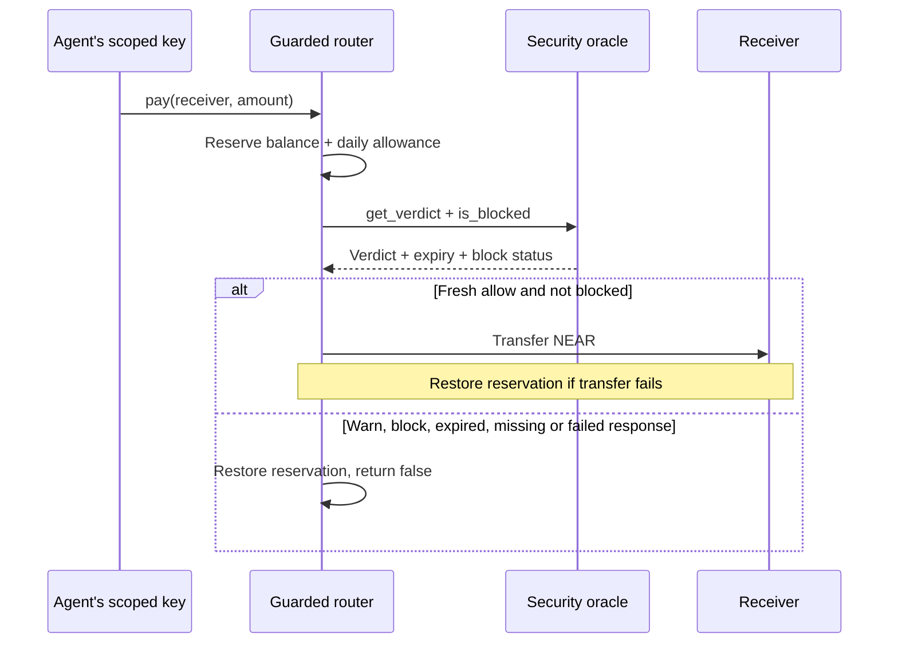

# On-chain payment guard

Two contracts keep the payment rules outside the agent's prompt.

| Contract | Job |
|---|---|
| [security_oracle](security_oracle/src/lib.rs) | Trusted attesters publish `allow / warn / block`; confirmed evidence reports override verdicts |
| [guarded_router](guarded_router/src/lib.rs) | Holds the human's funds and pays only with a fresh `allow`, no block, and enough balance and daily allowance |



## Build and verify

Needs Rust/rustup. [rust-toolchain.toml](rust-toolchain.toml) pins Rust 1.95.0 and the WASM target.

```bash
cargo +1.95.0 install cargo-near --version 0.23.0 --locked  # once
cd near/contract
cargo test
```

Expected: **18 tests passing**, using real WASM on a local NEAR sandbox. The first run downloads the sandbox
and compiles the contracts. Tests cover payments, refusals and refunds, access-key restrictions, spending limits,
private callbacks, report confirmation, expiry, and permanent attester revocation.

Build output: `target/near/{security_oracle,guarded_router}/*.wasm`.
Then run the [agent attack demo](../agent/README.md) to see all three payment barriers in action.

## Main methods

Full signatures and validation live in the linked source files above; amounts use yoctoNEAR decimal strings.

| Contract / caller | Methods | Effect |
|---|---|---|
| Oracle / attester | `submit_verdict` | Publish verdict, code hash, score, reasons hash and expiry; maximum TTL 7 days |
| Oracle / anyone | `report` | Attach evidence URL + SHA-256 and pay storage; pending reports alone do not block |
| Oracle / attester | `confirm_report`, `dismiss_report` | Confirm a block or dismiss a report |
| Oracle / owner | `add_attester`, `remove_attester`, `unblock` | Manage trust; requires 1 yoctoNEAR |
| Oracle / views | `get_verdict`, `is_blocked`, `get_reports` | Read verdicts and evidence history |
| Router / human owner | `deposit`, `set_limit`, `withdraw` | Fund a direct sub-account's balance, set cap, reclaim funds |
| Router / agent | `pay` | Zero attached deposit; use 100 Tgas; returns `true` on transfer, `false` on refusal |
| Router / views | `get_agent`, `get_oracle` | Read balance, spending and configured oracle |

`set_limit` and `withdraw` require 1 yoctoNEAR. Agent registration pays its storage cost from the first deposit.
The router reserves funds **before** async calls; private callbacks restore failed payments. NEP-297 events
record payments and refusal reasons. The agent's [function-call key](../agent/README.md) cannot withdraw funds.

## Trust and limits

- **Trusted attesters:** a compromised operator can publish false verdicts until removed. Removal permanently
  revokes its old verdicts, even after re-adding it. Fresh verdicts are required. Confirmed reports remain blocked
  until the owner explicitly unblocks them.
- **Stale code:** the router cannot compare the receiver's current code hash with the attested hash. Short TTLs
  and re-attestation after redeployment reduce this gap; they do not eliminate it.
- **Warnings:** human approval in the wrapper does not override an on-chain `warn`. A human who chooses to proceed
  must make a separate payment from their own wallet.
- **Daily cap:** resets at UTC block-timestamp midnight; it is not a rolling 24-hour limit.
- **Deployment:** sandbox-tested, not audited or deployed to testnet/mainnet. Use a fresh oracle deployment:
  this revision adds attester generations to storage and includes no migration for older state.
