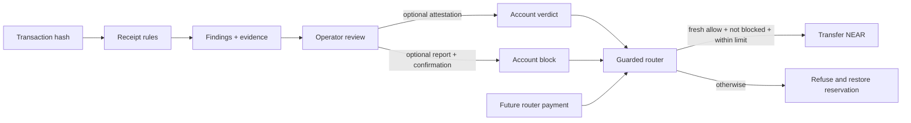

# Optional on-chain response layer

The **Security Oracle** analyzes a transaction hash and returns receipt-rule findings for operator review.
These contracts optionally record **account-level** decisions and restrict **future payments through this router**.
They do not analyze receipts, revert completed transactions, or pause arbitrary protocols.



A detector finding does **not** automatically publish a verdict or confirm a report. An authorized operator must
choose a response. The [relay](../agent/src/attester_relay.js) publishes `/v1/check` account verdicts, not transaction
scores. Evidence reports are a separate workflow.

| Contract | Job |
|---|---|
| [security_oracle](security_oracle/src/lib.rs) | Trusted attesters publish account `allow / warn / block`; confirmed evidence reports override verdicts |
| [guarded_router](guarded_router/src/lib.rs) | Holds owner-funded balances and enforces account verdicts, expiry and spending limits on its payments |

## Build and verify

Needs Rust/rustup. [rust-toolchain.toml](rust-toolchain.toml) pins Rust 1.95.0 and the WASM target.

```bash
cargo +1.95.0 install cargo-near --version 0.23.0 --locked  # once
cd near/contract
cargo test
```

Run `uv sync` from the repository root first; the pre-approval tests invoke the Python API from `.venv`.
Expected: **21 tests passing**, using real WASM on a local NEAR sandbox. The first run downloads the sandbox
and compiles the contracts. Tests cover payments, refusals and refunds, access-key restrictions, spending limits,
private callbacks, evidence reports, expiry, and permanent attester revocation.

Build output: `target/near/{security_oracle,guarded_router}/*.wasm`.
The [adapter integration demo](../agent/README.md) exercises future-payment restrictions separately from detection.

## Main methods

Full signatures and validation live in the source files above; amounts use yoctoNEAR decimal strings.

| Contract / caller | Methods | Effect |
|---|---|---|
| Oracle / attester | `submit_verdict` | Publish account verdict, code hash, score, reasons hash and expiry; maximum TTL 7 days |
| Oracle / anyone | `report` | Attach evidence URL + SHA-256 and pay storage; pending reports alone do not block |
| Oracle / attester | `confirm_report`, `dismiss_report` | Confirm an account block or dismiss a report |
| Oracle / owner | `add_attester`, `remove_attester`, `unblock` | Manage trust; requires 1 yoctoNEAR |
| Oracle / owner | `set_preapproval_key` | Set a base64 Ed25519 public key, or `null` to disable; requires 1 yoctoNEAR; revokes old approvals |
| Oracle / views | `verify_preapproval`, `get_preapproval_key` | Verify a signed payment; read `[public_key, generation]` |
| Oracle / views | `get_verdict`, `is_blocked`, `get_reports` | Read account verdicts and evidence history |
| Router / owner | `deposit`, `set_limit`, `withdraw` | Fund a direct sub-account's balance, set cap, reclaim funds |
| Router / agent | `pay` | Optional `preapproval` proof; zero attached deposit; use 100 Tgas; returns `true` on transfer, `false` on refusal |
| Router / views | `get_agent`, `get_oracle` | Read balance, spending and configured oracle |
| Router / views | `get_preapproval_nonce` | Read the next nonce for `agent_id` before requesting a signature |

`set_limit` and `withdraw` require 1 yoctoNEAR. Registration pays storage from the first deposit.
The router reserves funds **before** async calls; private callbacks restore failed payments. NEP-297 events
record outcomes. The [function-call key](../agent/README.md) cannot withdraw funds or bypass the router.

## Signed pre-approvals

An operator can approve an exact payment through `POST /v1/preapprovals` with the admin token.
The backend returns an Ed25519 signature; `verify_preapproval` returns `true` only when its scope,
signature, key generation and expiry are valid and the receiver has no block verdict or confirmed block.
The router accepts it without an existing allow verdict, while retaining balance and daily-limit checks.
[Backend setup and example](../README.md#signed-payment-pre-approvals).

The signed UTF-8 message joins these values with `\n`, with no trailing newline:

```text
security-oracle:preapproval:v1
<oracle account ID>
<consumer/router account ID>
<agent account ID>
<receiver account ID>
<amount in yoctoNEAR>
<nonce>
<key generation>
<issued_at_ns>
<expires_at_ns>
```

All numbers are canonical decimal strings. Keys and signatures are raw Ed25519 bytes encoded as base64.
TTL defaults to five minutes and cannot exceed fifteen minutes. Each key update increments the generation,
including disabling and reinstalling the same key. Use a different signing key for every network.
The oracle view verifies authorization only; it does not consume the nonce. The router consumes it before
its asynchronous oracle call, including refused/failed payments. Fetch a fresh nonce and approval after a
failed attempt. Invalid signatures refuse and restore the reserved funds and daily allowance.

## Trust and limits

- **Trusted operators:** compromised attesters can publish false verdicts until removed. Removal permanently
  revokes old verdicts, even after re-adding the attester. Confirmed reports stay blocked until the owner unblocks them.
- **Stale code:** the router cannot compare current receiver code with the attested hash. Short TTLs and
  re-attestation after redeployment reduce this gap; they do not eliminate it.
- **Warnings:** a terminal confirmation alone does not override an on-chain `warn`; an operator-signed
  pre-approval can authorize an exact payment. Blocks still take precedence.
- **Scope:** only this router's payments are restricted. Its daily cap resets at UTC block-timestamp midnight.
- **Deployment:** sandbox-tested, not audited or deployed to testnet/mainnet. Use fresh oracle and router
  deployments: this revision adds signing-key and nonce state and includes no migration for older state.
