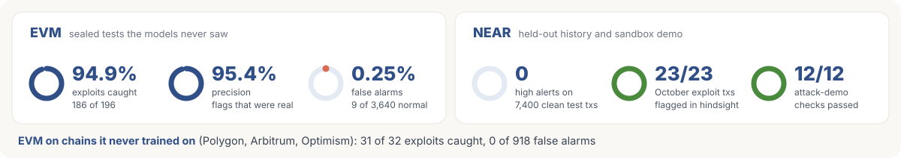

# Intents detector: evidence

[Overview](../../../README.md) · [Raw evaluation](evaluation.json) · [Paused-traffic diagnostic](paused_diagnostic.json)

**In the served baseline evaluation, rules supplied every campaign detection. The anomaly model added none.**

## Accounting, history and family training

The served detector now adds exact deposit/refund event accounting, strictly earlier participant history, and
[11 attack categories](../fixtures/attack_taxonomy.json). These checks added **no alerts on the 7,400 historical
normal transactions**. The frozen ML model remains active.

| New research experiment | Existing baseline / rules | Selected learned model |
|---|---:|---:|
| Real cases flagged, family-held-out development tests | 204/430 | **353/430** |
| High alerts on historical normal transactions | 0/7,400 | **14/7,400** |
| High alerts on held-out sandbox benign flows | 0/40 | **26/40** |

**Candidate rejected.** Higher development recall came with high-severity false alarms. Generated benign flows
were also perfectly distinguishable from sampled real traffic in a separate source-classification check.
No thresholds were retuned after these results. This is development evidence, not a new sealed accuracy claim.

Training used four fixed configurations with separate calibration/selection windows, category holdouts, and
held-out sandbox methods, receiver modes and actors. Four attacker-adjacent normal rows were excluded. Seven of
the original 437 attack-labelled transactions never reach Intents; they retain their labels outside the classifier's
430-case scope. Historical measurements below retain their original denominators.

| Added data | What it establishes |
|---|---|
| **273 sandbox executions**: 6 measured exploits, 132 attempts, 135 benign | Four observable families; 91 rows per split, with shared generator/WASM limitations |
| **3 sourced exploit transactions**: Rhea and Skyward | Two additional families, currently outside Intents coverage |
| **500 fresh transactions**, labels unknown | No alerts observed; a correlated 112-second sample, not a false-positive-rate estimate |

[Training results](transactions_v2.json) · [Sandbox provenance](synthetic_families_v2.json) ·
[Real case sources](../fixtures/cases_v2/manifest.json) · [Run or reproduce](../../README.md)

## Results

| Campaign | High | Medium | Missed |
|---|---:|---:|---:|
| October exploit | **23** | 0 | 0 |
| April out-of-gas attempts | 0 | 53 | 2 |
| May admin fuzzing | 0 | 110 | 67 |
| May token spoofing | 0 | 18 | 164 |
| Team regression tests (negatives) | 0 | **12 false alarms** | 5 |

The 23 exploits repeat one technique by one actor. Rules were written after observing these campaigns;
these are retrospective case studies, **not unseen-attack accuracy**. Setup and cashout transactions have ordinary
shapes and are not detected.

| Clean test normals (7,400 transactions) | High alerts | Medium or higher |
|---|---:|---:|
| Rules only | 0 | 0 |
| Rules + anomaly model | **0** | **84 (1.14%)** |

Zero observed high alerts has a 95% Wilson upper bound of **0.052%**, not a zero population false-positive rate.
80 of the 84 medium alerts came from deposits during one paused-contract hour. The medium target of 0.1% was
missed. Excluding paused traffic gives 4/7,301 alerts, but that exclusion is post hoc.

**Interpretation:** transaction findings guide protocol investigation. The optional receiver-policy integration warns on high Intents activity; transaction scoring itself does not block anything.

<details>
<summary>November 14 retraining: candidate rejected</summary>

Trained three forests: global, per-flow, and per-flow with receipt-failure groups. Fit, threshold calibration and
selection used separate time windows. Selection chose the global model before retrospective scoring.

| Same 7,400 historical normal transactions | Current model | Candidate |
|---|---:|---:|
| High alerts | 0 | 0 |
| Medium+ alerts | 84 | 92 |
| Additional campaign detections | — | 0 |

The candidate failed the noise-reduction check; served weights are unchanged. These are previously examined
transactions, not a fresh test. The four attacker-adjacent training rows remain a documented data limitation.
[Protocol, coverage and measurements](training_candidate.json) · [Trainer](../train_candidate.py)

</details>

## What was evaluated

| Slice | Period | Transactions |
|---|---|---:|
| Train | Nov 2024–May 2026 | 69,863 |
| Calibration | Jun–Sep 2026 | 17,772 |
| Test | Oct–Nov 2026 | 12,463 |

IsolationForest uses 63 receipt-graph features alongside 12 rules. No labelled campaign trained the anomaly model.
Use `label` for decisions: `risk` includes an anomaly percentile and is not a probability of attack.

## Limits that matter

- **Clean sample:** only 7,400 test rows are independent of rule development. The other 5,063 test rows and 2,672
  calibration rows were scouting seeds used while developing rules. Samples arrive in consecutive pages;
  correlated transactions make independent-sample confidence intervals optimistic.
- **Feature design saw the exploit.** Replacing 11 rule-like features with training medians removes the anomaly
  model's October detection. Its value against unseen attacks is unproven.
- **Sparse calibration:** no withdrawals, only 227 other-flow transactions, and one permitted high alert.
  A 1-in-10,000 high false-alarm rate is not established by this sample.
- **Historical false alarms:** rules flagged 327/69,863 training normals at medium. One training and one calibration
  normal triggered high rules; neither was investigated. Quiet test months do not guarantee quiet future traffic.
- **Training contamination:** four training normals were signed by an attacker-adjacent setup account. Future
  collection excludes these signers; the shipped model was not retrained.
- **Receiver coverage:** only 40 recent index rows / 20 Intents transactions, cached five minutes. History can be
  pushed out of the window; merely appearing in a suspicious receipt can cause a warning.

<details>
<summary>Evaluation history and reproduction</summary>

Model selection changed once after calibration revealed a candidate's score ceiling was unusable; see
[initial selection](freeze_first_pass.json). The test was scored twice following a nonfunctional code-hash change:
[first run](evaluation_sealed_run1.json) and [current run](evaluation.json) have the same measurements.
Paused-traffic analysis, source splits and feature ablation were performed after seeing test results.

A synthetic-data head was **not adopted**: it added zero detections and promoted 80 normal transactions to high.
Its adoption decision also read the test set. See [head results](head_evaluation.json),
[domain check](head_domain_check.json) and [sandbox setup](../synthetic/README.md).

The former 97,000-transactions/day planning estimate was unverified. Do not extrapolate the sample into an
operational daily-alert claim; bursty paused traffic dominates the pooled rate.

```bash
uv run python -m near.demo.replay
uv run python -m unittest near.intents.test_model near.service.test_intents
```

`archives/near_intents.zip` supplies the frozen model and labelled data. It excludes the 239 MB normals and scouting
seeds. Re-pulling normals does not reproduce the exact sample. `near.intents.model freeze` replaces model artifacts;
`near.intents.evaluate run --rescore` replaces evaluation results. Preserve the shipped evidence before either.

</details>

<details>
<summary>Detailed campaign breakdown and sampled precision</summary>

The agent flags risk; it does not fix contracts or stop transactions. **High** is shown as *Malicious pattern*,
**medium** as *Suspicious*, **low** as *No known attack pattern*.

**How to read the numbers**

- **Recall:** of the real attacks, how many it flagged.
- **Precision:** of everything it flagged, how many were real attacks.
- **False alarms:** of normal activity, how much it flagged by mistake.
- **`84 / 7,400 (1.1%)`:** we took 7,400 normal Intents transactions from Oct–Nov 2026, kept out of training and
  rule writing. It wrongly flagged 84 of them at medium and none at high. 80 of the 84 came from one hour on
  2026-10-01, when Intents was paused and deposits failed. All 84 came from the anomaly model; the rules alone
  flagged none.



### NEAR Intents transactions

Rules were written after studying these attacks, so this is a look back at known attacks, not a test on new ones.

| Attack type | Example | Main rules that fired | Caught at high | Caught at medium or higher |
|---|---|---|---|---|
| Deposit callback overflows its log, credit kept | Sep 29–Oct 1 2026 exploit, about $3.8M | failed callback, log limit, credit kept | **23 / 23** | 23 / 23 |
| Callback runs out of gas | Apr 2026 attempts | notify in deposit, callback out of gas | 0 / 55 | **53 / 55** |
| Private or admin method called by an outsider | May 2026 fuzzing | private method called directly, admin method | 0 / 177 | **110 / 177** |
| Fake-token deposits | May 2026 token spoofing | private method called directly (the 18 caught); the rest look like normal failed intents | 0 / 182 | **18 / 182** |
| *Normal traffic (false alarms)* | 7,400 unseen transactions | — | **0 / 7,400** | 84 / 7,400 |

| | High | Medium or higher |
|---|---|---|
| Recall, all 437 attack transactions | 23 / 437 = 5% (the exploit: 23 / 23) | 204 / 437 = 47% |
| False alarms, 7,400 normal transactions | 0 = 0% | 84 = 1.1% |
| Precision on our test set | 23 / 23 = **100%** | 204 / 300 = 68% |

Precision here uses 437 attacks against 7,417 normal transactions (the 7,400 above plus 17 team tests, 12 flagged
at medium). 5,063 more test transactions were used while writing the rules, so they are left out. Real traffic has
far fewer attacks, so live precision at medium is much lower. The 23 exploit transactions are one attacker
repeating one technique; the attacker's 52 setup and cash-out transactions look normal and were not flagged.

</details>
